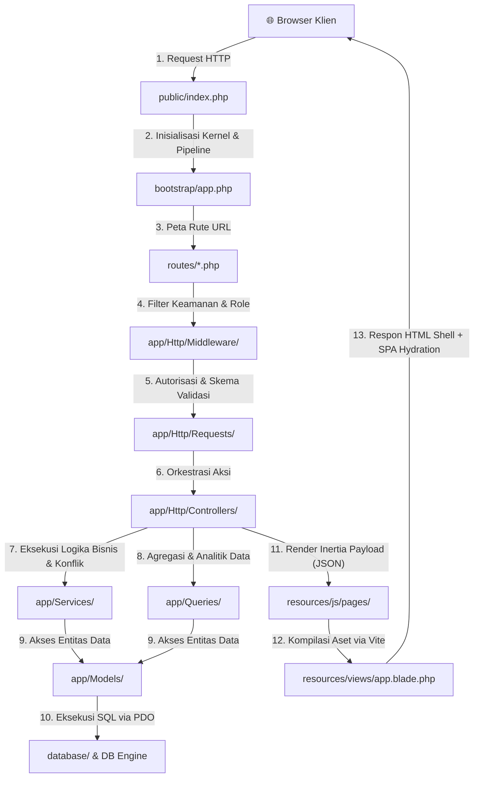

# BEDAH STRUKTUR FOLDER TREE & ANATOMI CODEBASE ADUPDF
**Panduan Komprehensif Arsitektur Direktori, Peran, dan Interelasi Antar-Folder Repositori AduPDF**

---

## DAFTAR ISI
1. [BAB 1: Filosofi & Paradigma Arsitektur Struktur Direktori](#1-bab-1-filosofi--paradigma-arsitektur-struktur-direktori)
2. [BAB 2: Peta Master Tree Keseluruhan (Exhaustive Visual Tree)](#2-bab-2-peta-master-tree-keseluruhan-exhaustive-visual-tree)
3. [BAB 3: Bedah Direktori Sisi Server (Backend Core)](#3-bab-3-bedah-direktori-sisi-server-backend-core)
   - [3.1 Direktori `app/` (Otak & Logika Bisnis Aplikasi)](#31-direktori-app-otak--logika-bisnis-aplikasi)
   - [3.2 Direktori `bootstrap/` (Titik Booting & Pipeline Runtime)](#32-direktori-bootstrap-titik-booting--pipeline-runtime)
   - [3.3 Direktori `config/` (Pusat Kendali Konfigurasi Framework)](#33-direktori-config-pusat-kendali-konfigurasi-framework)
   - [3.4 Direktori `routes/` (Peta Navigasi & Alamat URL Aplikasi)](#34-direktori-routes-peta-navigasi--alamat-url-aplikasi)
4. [BAB 4: Bedah Direktori Data & Persistensi](#4-bab-4-bedah-direktori-data--persistensi)
   - [4.1 Direktori `database/` (Cetak Biru Skema & Data Awal)](#41-direktori-database-cetak-biru-skema--data-awal)
   - [4.2 Direktori `storage/` (Penyimpanan Berkas Internal & Cache Runtime)](#42-direktori-storage-penyimpanan-berkas-internal--cache-runtime)
5. [BAB 5: Bedah Direktori Sisi Klien (Frontend Core)](#5-bab-5-bedah-direktori-sisi-klien-frontend-core)
   - [5.1 Direktori `resources/` (Dapur Antarmuka Pengguna: React, Tailwind, Blade)](#51-direktori-resources-dapur-antarmuka-pengguna-react-tailwind-blade)
   - [5.2 Direktori `public/` (Gerbang Web Server & Aset Publik Terbuka)](#52-direktori-public-gerbang-web-server--aset-publik-terbuka)
6. [BAB 6: Bedah Direktori Pengujian, Dokumentasi & File Root](#6-bab-6-bedah-direktori-pengujian-dokumentasi--file-root)
   - [6.1 Direktori `tests/` (Jaminan Mutu & Otomasi Pengujian Pest)](#61-direktori-tests-jaminan-mutu--otomasi-pengujian-pest)
   - [6.2 Direktori `docs/` (Pusat Arsip Desain, SRS & Modul Pembelajaran)](#62-direktori-docs-pusat-arsip-desain-srs--modul-pembelajaran)
   - [6.3 File Konfigurasi di Root Directory (The Root Orchestrators)](#63-file-konfigurasi-di-root-directory-the-root-orchestrators)
7. [BAB 7: Matriks Navigasi Cepat ("If You Want to Find X, Look in Y")](#7-bab-7-matriks-navigasi-cepat-if-you-want-to-find-x-look-in-y)

---

## 1. BAB 1: FILOSOFI & PARADIGMA ARSITEKTUR STRUKTUR DIREKTORI

Struktur folder AduPDF tidak mengikuti pola aplikasi web tradisional yang memisahkan proyek menjadi dua repository terpisah (*decoupled frontend-backend repos*), melainkan menerapkan paradigma **Modern Modular Monolith**.

### Mengapa Struktur Folder Ini Dipilih?
1. **Single Source of Truth (Satu Repositori Terpadu)**: Kode backend (Laravel 12) dan frontend (React 19 + TypeScript) berada dalam satu pohon direktori. Hal ini memungkinkan integrasi tipe yang mulus tanpa sinkronisasi API manual via OpenAPI/Swagger.
2. **Jembatan Monolitik via Inertia.js**: Direktori [`resources/js/pages/`](file:///B:/0000_UNDIP/5.%20SMT%205/PPK_PROJECTS/AduPDF_Local/AduPDF/resources/js/pages/) langsung berkorespondensi dengan respons yang dikembalikan oleh [`app/Http/Controllers/`](file:///B:/0000_UNDIP/5.%20SMT%205/PPK_PROJECTS/AduPDF_Local/AduPDF/app/Http/Controllers/).
3. **Pemisahan Tanggung Jawab (*Separation of Concerns*)**:
   - Logika bisnis murni diisolasi di [`app/Services/`](file:///B:/0000_UNDIP/5.%20SMT%205/PPK_PROJECTS/AduPDF_Local/AduPDF/app/Services/).
   - Validasi data diisolasi di [`app/Http/Requests/`](file:///B:/0000_UNDIP/5.%20SMT%205/PPK_PROJECTS/AduPDF_Local/AduPDF/app/Http/Requests/).
   - Kueri pelaporan analitis diisolasi di [`app/Queries/`](file:///B:/0000_UNDIP/5.%20SMT%205/PPK_PROJECTS/AduPDF_Local/AduPDF/app/Queries/).
   - Skema basis data terpusat di [`database/migrations/`](file:///B:/0000_UNDIP/5.%20SMT%205/PPK_PROJECTS/AduPDF_Local/AduPDF/database/migrations/).
   - Komponen UI presentasional terpusat di [`resources/js/components/`](file:///B:/0000_UNDIP/5.%20SMT%205/PPK_PROJECTS/AduPDF_Local/AduPDF/resources/js/components/).

### Diagram Alur Lalu Lintas Data Antar-Direktori (*Directory Traffic Flow*)



---

## 2. BAB 2: PETA MASTER TREE KESELURUHAN (EXHAUSTIVE VISUAL TREE)

Berikut adalah representasi visual pohon direktori menyeluruh dari repositori AduPDF:

```text
AduPDF/
├── .agents/                                # Definisi skill agen AI otomatis
├── .github/                                # Konfigurasi CI/CD workflow GitHub Actions
├── app/                                    # [BACKEND CORE] Otak & Logika Bisnis
│   ├── Actions/Fortify/                    # Aksi otentikasi (CreateNewUser, ResetPassword)
│   ├── Concerns/                           # Traits reusable (validasi password & profile)
│   ├── Enums/                              # PHP 8 Backed Enums (Status, Tipe, Kondisi)
│   ├── Http/
│   │   ├── Controllers/                    # Orkestrasi alur HTTP
│   │   │   ├── Admin/                      # Controllers kelola akun, fasilitas, rekap
│   │   │   ├── Auth/                       # Controllers sesi login & registrasi
│   │   │   ├── Settings/                   # Controllers profil & keamanan
│   │   │   ├── FacilityController.php      # Controller katalog fasilitas publik
│   │   │   ├── PetugasDashboardController.php # Dashboard operasional petugas
│   │   │   ├── PetugasReportController.php # Penanganan laporan oleh petugas
│   │   │   ├── PetugasReservationController.php # Persetujuan reservasi oleh petugas
│   │   │   ├── ReportController.php        # Pelaporan kerusakan oleh pengguna
│   │   │   └── ReservationController.php   # Pengajuan reservasi oleh pengguna
│   │   ├── Middleware/                     # Pipeline penyaring request HTTP
│   │   └── Requests/                       # Form validation & authorization schemas
│   │       ├── Admin/                      # Validasi input admin
│   │       └── Settings/                   # Validasi profil & kata sandi
│   ├── Models/                             # Active Record Eloquent Models (User, Facility, dll)
│   ├── Providers/                          # Service Providers (AppServiceProvider, Fortify)
│   ├── Queries/                            # Dedicated Query Object classes untuk laporan/antrean
│   └── Services/                           # Domain Services logika murni (Conflict, Availability)
│       └── Export/                         # Layanan export rekap (PDF, Excel, CSV)
├── bootstrap/                              # [BOOTSTRAP] Bootloader & Konfigurasi Pipeline
│   ├── app.php                             # Inisialisasi rute, middleware, cron, exceptions
│   └── providers.php                       # Registrasi provider framework
├── config/                                 # [CONFIG] Pusat Kendali Pengaturan Framework (12 files)
│   ├── app.php, auth.php, cache.php, database.php, filesystems.php, fortify.php,
│   └── inertia.php, logging.php, mail.php, queue.php, services.php, session.php
├── database/                               # [DATA BLUEPRINT] Skema Database & Data Awal
│   ├── factories/                          # Generator data dummy untuk testing (Faker)
│   ├── migrations/                         # DDL skema tabel (users, facilities, reservations, dll)
│   └── seeders/                            # Seeder data awal (AdminUserSeeder, FacilitySeeder)
├── docs/                                   # [DOCUMENTATION] Dokumentasi Teknis & Modul Pembelajaran
│   ├── AduPDF_Design.md, AduPDF_SRS.md, DEPLOYMENT_GUIDE.md, Pemetaan_Audit_SRS_Jobdesc.md,
│   ├── MODUL_PEMBELAJARAN_ARSITEKTUR_DAN_ENGINEERING_ADUPDF.md,
│   ├── PANDUAN_DECODER_SINTAKS_DAN_FUNDAMENTAL_KODE_ADUPDF.md,
│   └── BEDAH_STRUKTUR_FOLDER_TREE_DAN_ANATOMI_CODEBASE_ADUPDF.md (File ini)
├── public/                                 # [WEB ROOT] Pintu Gerbang Publik Web Server
│   ├── .htaccess                           # Apache rewrite engine rules
│   ├── favicon.ico, favicon.svg, dsb.      # Aset favicon & ikon browser
│   ├── index.php                           # Single entry point PHP FastCGI
│   └── robots.txt                          # Direktif crawler mesin pencari
├── resources/                              # [FRONTEND SOURCE] Dapur Tampilan Antarmuka
│   ├── css/                                # Tailwind CSS v4 styling & theme setup (app.css)
│   ├── images/                             # Berkas gambar statis (LOGO.jpg)
│   ├── js/                                 # Sumber kode TypeScript & React 19
│   │   ├── actions/                        # Wayfinder typed controller actions
│   │   ├── components/                     # Komponen UI deklaratif & reaktif
│   │   │   └── ui/                         # Primitif komponen UI (button, dialog, input, dsb)
│   │   ├── hooks/                          # Custom React Hooks (use-appearance, use-mobile)
│   │   ├── layouts/                        # Shell layout halaman (app-layout, admin-layout)
│   │   ├── lib/                            # Helper utilitas (utils.ts / cn class merger)
│   │   ├── pages/                          # View Controllers Inertia (admin, auth, facilities, dll)
│   │   ├── routes/                         # Wayfinder typed named route functions
│   │   ├── types/                          # Definisi tipe & kontrak TypeScript
│   │   ├── app.tsx                         # Client-side entry point (createInertiaApp)
│   │   └── ssr.tsx                         # Server-Side Rendering entry point
│   └── views/                              # Template Blade Root
│       ├── app.blade.php                   # Single HTML host shell (<x-inertia::app />)
│       └── sitemap.blade.php               # Generator XML sitemap
├── routes/                                 # [ROUTING] Peta Navigasi & Alamat URL Modular (11 files)
│   ├── web.php                             # Aggregator rute utama
│   ├── auth.php, admin-accounts.php, admin-facilities.php, admin-recap.php,
│   ├── dashboards.php, facilities.php, reports.php, reservations.php, settings.php,
│   └── console.php                         # Definisi scheduled artisan commands
├── storage/                                # [RUNTIME STORAGE] Penyimpanan Berkas & Cache Sesi
│   ├── app/                                # Berkas privat aplikasi (reports attachments)
│   ├── framework/                          # Cache framework, sessions, views compiled
│   └── logs/                               # Catatan log error (laravel.log)
├── tests/                                  # [TEST SUITE] Pengujian Otomatis Pest (205 Tests)
│   ├── Feature/                            # Feature tests end-to-end (Auth, Reservations, Reports)
│   ├── Unit/                               # Unit tests logika terisolasi
│   ├── Pest.php                            # Konfigurasi pest runner & binding hooks
│   └── TestCase.php                        # Base testing class TestCase
├── .editorconfig, .gitattributes, .gitignore # Konfigurasi IDE & VCS Git
├── artisan                                 # CLI Command Runner Laravel
├── composer.json & composer.lock           # Manajemen dependensi PHP
├── package.json & package-lock.json        # Manajemen dependensi Node.js / React
├── phpstan.neon & phpunit.xml              # Konfigurasi analisis statis PHP & unit test
├── tsconfig.json                           # Konfigurasi kompilasi TypeScript
└── vite.config.ts                          # Konfigurasi bundler Vite + Inertia + Tailwind
```

---

## 3. BAB 3: BEDAH DIREKTORI SISI SERVER (BACKEND CORE)

Direktori backend bertanggung jawab penuh atas pemrosesan request HTTP, penegakan otorisasi, validasi data masukan, eksekusi algoritma bisnis, dan persistensi database.

---

### 3.1 Direktori `app/` (Otak & Logika Bisnis Aplikasi)

`app/` adalah jantung utama kode aplikasi PHP. Direktori ini di-autoload oleh Composer di bawah namespace `App\`.

#### A. `app/Actions/Fortify/`
* **Definisi:** Kumpulan kelas aksi tunggal (*Single Action Classes*) yang dipicu oleh paket autentikasi Laravel Fortify.
* **Kenapa diletakkan di sini:** Memisahkan alur pendaftaran akun dan pemulihan kata sandi dari controller biasa, sehingga logika registrasi dapat diuji secara terisolasi tanpa overhead HTTP session.
* **Berkas Kunci:**
  - [`CreateNewUser.php`](file:///B:/0000_UNDIP/5.%20SMT%205/PPK_PROJECTS/AduPDF_Local/AduPDF/app/Actions/Fortify/CreateNewUser.php): Memvalidasi nama, email, password, nomor WhatsApp, dan membuat record model `User` baru dengan role default `pengguna`.
  - [`ResetUserPassword.php`](file:///B:/0000_UNDIP/5.%20SMT%205/PPK_PROJECTS/AduPDF_Local/AduPDF/app/Actions/Fortify/ResetUserPassword.php): Menangani reset password dan validasi token lupa password.

#### B. `app/Concerns/`
* **Definisi:** Berisi PHP *Traits* yang membagikan potongan logika validasi lintas kelas (*cross-cutting concerns*).
* **Kenapa diletakkan di sini:** Menghindari duplikasi aturan validasi (*DRY - Don't Repeat Yourself*).
* **Berkas Kunci:**
  - [`PasswordValidationRules.php`](file:///B:/0000_UNDIP/5.%20SMT%205/PPK_PROJECTS/AduPDF_Local/AduPDF/app/Concerns/PasswordValidationRules.php): Menyediakan aturan standar kata sandi (minimal 8 karakter, konfirmasi password).
  - [`ProfileValidationRules.php`](file:///B:/0000_UNDIP/5.%20SMT%205/PPK_PROJECTS/AduPDF_Local/AduPDF/app/Concerns/ProfileValidationRules.php): Aturan format identitas institusional (NIM/NIP) dan nomor telepon.

#### C. `app/Enums/`
* **Definisi:** Definisi tipe data terbilang berkarakter nilai (*PHP 8 Backed Enums*).
* **Kenapa diletakkan di sini:** Mengeliminasi penggunaan string mentah (*magic strings*) di seluruh aplikasi, menjamin konsistensi nilai status antara backend, database, dan frontend.
* **Berkas Kunci:**
  - [`ReservationStatus.php`](file:///B:/0000_UNDIP/5.%20SMT%205/PPK_PROJECTS/AduPDF_Local/AduPDF/app/Enums/ReservationStatus.php): Mendefinisikan status reservasi (`menunggu`, `disetujui`, `ditolak`, `dibatalkan`).
  - [`ReportStatus.php`](file:///B:/0000_UNDIP/5.%20SMT%205/PPK_PROJECTS/AduPDF_Local/AduPDF/app/Enums/ReportStatus.php): Mendefinisikan status laporan kerusakan (`baru`, `diproses`, `selesai`, `ditolak`).
  - [`FacilityType.php`](file:///B:/0000_UNDIP/5.%20SMT%205/PPK_PROJECTS/AduPDF_Local/AduPDF/app/Enums/FacilityType.php): Membedakan jenis fasilitas (`ruangan`, `alat`).
  - [`FacilityCondition.php`](file:///B:/0000_UNDIP/5.%20SMT%205/PPK_PROJECTS/AduPDF_Local/AduPDF/app/Enums/FacilityCondition.php): Kondisi fisik fasilitas (`berfungsi`, `rusak_sebagian`, `rusak_total`).

#### D. `app/Http/Controllers/`
* **Definisi:** Lapisan pengontrol alur (*Traffic Orchestrator*) yang menerima request HTTP, memanggil service bisnis, dan mengembalikan respons Inertia/JSON/Redirect.
* **Struktur Pembagian Subfolder:**
  - `Admin/`: Mengontrol fitur khusus administrator kampus:
    - [`AccountManagementController.php`](file:///B:/0000_UNDIP/5.%20SMT%205/PPK_PROJECTS/AduPDF_Local/AduPDF/app/Http/Controllers/Admin/AccountManagementController.php): Persetujuan dan penonaktifan akun mahasiswa/petugas.
    - [`FacilityManagementController.php`](file:///B:/0000_UNDIP/5.%20SMT%205/PPK_PROJECTS/AduPDF_Local/AduPDF/app/Http/Controllers/Admin/FacilityManagementController.php): Tambah, edit, dan hapus data master fasilitas.
    - [`RecapController.php`](file:///B:/0000_UNDIP/5.%20SMT%205/PPK_PROJECTS/AduPDF_Local/AduPDF/app/Http/Controllers/Admin/RecapController.php): Cetak rekapitulasi data ke format PDF, Excel, dan CSV.
  - `Auth/`: Mengontrol sesi login dan logout:
    - [`AuthenticatedSessionController.php`](file:///B:/0000_UNDIP/5.%20SMT%205/PPK_PROJECTS/AduPDF_Local/AduPDF/app/Http/Controllers/Auth/AuthenticatedSessionController.php): Form login, autentikasi password, dan penghancuran sesi.
  - `Settings/`: Mengontrol preferensi akun mandiri:
    - [`ProfileController.php`](file:///B:/0000_UNDIP/5.%20SMT%205/PPK_PROJECTS/AduPDF_Local/AduPDF/app/Http/Controllers/Settings/ProfileController.php): Pembaruan identitas institusi dan sinkronisasi cookie `pending_reservation`.
  - Root Controllers:
    - [`FacilityController.php`](file:///B:/0000_UNDIP/5.%20SMT%205/PPK_PROJECTS/AduPDF_Local/AduPDF/app/Http/Controllers/FacilityController.php): Katalog daftar fasilitas dan detail ketersediaan jadwal.
    - [`ReservationController.php`](file:///B:/0000_UNDIP/5.%20SMT%205/PPK_PROJECTS/AduPDF_Local/AduPDF/app/Http/Controllers/ReservationController.php): Pengajuan dan pembatalan reservasi oleh pengguna biasa.
    - [`PetugasReservationController.php`](file:///B:/0000_UNDIP/5.%20SMT%205/PPK_PROJECTS/AduPDF_Local/AduPDF/app/Http/Controllers/PetugasReservationController.php): Persetujuan (*approve*) atau penolakan (*reject*) reservasi oleh petugas.
    - [`ReportController.php`](file:///B:/0000_UNDIP/5.%20SMT%205/PPK_PROJECTS/AduPDF_Local/AduPDF/app/Http/Controllers/ReportController.php): Pembuatan laporan kerusakan dan unggah bukti foto.

#### E. `app/Http/Middleware/`
* **Definisi:** Pintu penyaring (*HTTP Filters*) yang dieksekusi sebelum request mencapai controller.
* **Berkas Kunci:**
  - [`EnsureUserRole.php`](file:///B:/0000_UNDIP/5.%20SMT%205/PPK_PROJECTS/AduPDF_Local/AduPDF/app/Http/Middleware/EnsureUserRole.php): Mengisolasi hak akses berdasarkan role akun (`admin`, `petugas`, `pengguna`). Jika user berstatus *trashed*, otomatis me-logout dan membatalkan sesi.
  - [`EnsureUserActive.php`](file:///B:/0000_UNDIP/5.%20SMT%205/PPK_PROJECTS/AduPDF_Local/AduPDF/app/Http/Middleware/EnsureUserActive.php): Memastikan akun tidak dinonaktifkan oleh admin.
  - [`EnsureHasInstitutionalIdentity.php`](file:///B:/0000_UNDIP/5.%20SMT%205/PPK_PROJECTS/AduPDF_Local/AduPDF/app/Http/Middleware/EnsureHasInstitutionalIdentity.php): Mencegat user yang ingin meminjam fasilitas tetapi belum mengisi NIM/NIP, lalu mengarahkannya ke halaman profil.
  - [`HandleInertiaRequests.php`](file:///B:/0000_UNDIP/5.%20SMT%205/PPK_PROJECTS/AduPDF_Local/AduPDF/app/Http/Middleware/HandleInertiaRequests.php): Membagikan *shared data* global ke seluruh komponen React (data user aktif, flash messages, status sidebar).

#### F. `app/Http/Requests/`
* **Definisi:** Kelas *Form Request* yang mengisolasi aturan validasi dan otorisasi payload HTTP.
* **Kenapa diletakkan di sini:** Mencegah pencemaran kode controller (*clean controller pattern*) dan memastikan hanya data tervalidasi (`$request->validated()`) yang diproses.
* **Berkas Kunci:**
  - [`StoreReservationRequest.php`](file:///B:/0000_UNDIP/5.%20SMT%205/PPK_PROJECTS/AduPDF_Local/AduPDF/app/Http/Requests/StoreReservationRequest.php): Memvalidasi batas jam operasional kampus (07:00–20:00 WIB), interval 30 menit, dan mendeteksi kondisi fasilitas.
  - [`StoreReportRequest.php`](file:///B:/0000_UNDIP/5.%20SMT%205/PPK_PROJECTS/AduPDF_Local/AduPDF/app/Http/Requests/StoreReportRequest.php): Memvalidasi kategori kerusakan dan batas ukuran lampiran berkas (maksimal 5 file, maks 5MB, format JPG/PNG/PDF).

#### G. `app/Models/`
* **Definisi:** Kelas Active Record Eloquent yang memetakan baris tabel database ke objek PHP.
* **Berkas Kunci:**
  - [`User.php`](file:///B:/0000_UNDIP/5.%20SMT%205/PPK_PROJECTS/AduPDF_Local/AduPDF/app/Models/User.php): Entitas pengguna dengan dukungan autentikasi Fortify, Passkey, Two-Factor Authentication, Soft Deletes, dan proteksi `#[Hidden]`.
  - [`Facility.php`](file:///B:/0000_UNDIP/5.%20SMT%205/PPK_PROJECTS/AduPDF_Local/AduPDF/app/Models/Facility.php): Entitas fasilitas kampus (relasi hierarkis parent-child untuk ruangan dan alat di dalamnya).
  - [`Reservation.php`](file:///B:/0000_UNDIP/5.%20SMT%205/PPK_PROJECTS/AduPDF_Local/AduPDF/app/Models/Reservation.php): Entitas peminjaman fasilitas dengan casting enum status dan relasi ke user serta fasilitas.
  - [`Report.php`](file:///B:/0000_UNDIP/5.%20SMT%205/PPK_PROJECTS/AduPDF_Local/AduPDF/app/Models/Report.php): Entitas laporan aduan kerusakan dengan relasi ke lampiran gambar.
  - [`ReportAttachment.php`](file:///B:/0000_UNDIP/5.%20SMT%205/PPK_PROJECTS/AduPDF_Local/AduPDF/app/Models/ReportAttachment.php): Entitas metadata berkas bukti kerusakan.

#### H. `app/Providers/`
* **Definisi:** Tempat mengonfigurasi dan meregistrasikan layanan inti ke dalam Service Container Laravel saat aplikasi booting.
* **Berkas Kunci:**
  - [`AppServiceProvider.php`](file:///B:/0000_UNDIP/5.%20SMT%205/PPK_PROJECTS/AduPDF_Local/AduPDF/app/Providers/AppServiceProvider.php): Penyetelan default pagination, HTTPS scheme enforcement, dan registrasi service.
  - [`FortifyServiceProvider.php`](file:///B:/0000_UNDIP/5.%20SMT%205/PPK_PROJECTS/AduPDF_Local/AduPDF/app/Providers/FortifyServiceProvider.php): Konfigurasi rate limiting login (`throttle:login`, 5 percobaan per menit) dan kustomisasi view autentikasi.

#### I. `app/Queries/`
* **Definisi:** Kelas *Query Object Pattern* yang memisahkan kueri analitik, agregasi metrik, dan filter antrean kompleks dari model maupun controller.
* **Kenapa diletakkan di sini:** Kueri laporan yang melibatkan perhitungan persentase kerusakan atau occupancy rate memiliki kompleksitas tinggi. Mengisolasinya ke kelas tersendiri membuat kueri dapat diuji dan digunakan kembali (*reusable*) di banyak tempat.
* **Berkas Kunci:**
  - [`ReservationOccupancyQuery.php`](file:///B:/0000_UNDIP/5.%20SMT%205/PPK_PROJECTS/AduPDF_Local/AduPDF/app/Queries/ReservationOccupancyQuery.php): Menghitung persentase tingkat keterisian fasilitas per rentang tanggal.
  - [`ReservationQueueQuery.php`](file:///B:/0000_UNDIP/5.%20SMT%205/PPK_PROJECTS/AduPDF_Local/AduPDF/app/Queries/ReservationQueueQuery.php): Mengambil daftar antrean reservasi petugas dengan filter status dan kata kunci.
  - [`DamageStatisticsQuery.php`](file:///B:/0000_UNDIP/5.%20SMT%205/PPK_PROJECTS/AduPDF_Local/AduPDF/app/Queries/DamageStatisticsQuery.php): Mengagregasi metrik kerusakan fasilitas untuk dashboard admin.

#### J. `app/Services/`
* **Definisi:** Lapisan logika domain bisnis murni (*Domain Business Services*).
* **Kenapa diletakkan di sini:** Controller hanya bertugas mengatur lalu lintas HTTP; aturan bisnis sebenarnya berada di sini.
* **Berkas Kunci:**
  - [`ReservationConflictService.php`](file:///B:/0000_UNDIP/5.%20SMT%205/PPK_PROJECTS/AduPDF_Local/AduPDF/app/Services/ReservationConflictService.php): Mendeteksi bentrokan waktu peminjaman antara ruangan dan alat laboratorium di dalamnya dengan dukungan penguncian basis data (*pessimistic lock* `lockForUpdate()`).
  - [`FacilityAvailabilityService.php`](file:///B:/0000_UNDIP/5.%20SMT%205/PPK_PROJECTS/AduPDF_Local/AduPDF/app/Services/FacilityAvailabilityService.php): Menghitung slot waktu 30 menit yang masih kosong dari jam 07:00 hingga 20:00 WIB untuk kalender interaktif.
  - [`FacilityConditionService.php`](file:///B:/0000_UNDIP/5.%20SMT%205/PPK_PROJECTS/AduPDF_Local/AduPDF/app/Services/FacilityConditionService.php): Mengevaluasi apakah suatu fasilitas masih layak dipinjam berdasarkan laporan kerusakan aktif.
  - `Export/`: Berisi kelas eksportir rekapitulasi data:
    - [`PdfRecapExporter.php`](file:///B:/0000_UNDIP/5.%20SMT%205/PPK_PROJECTS/AduPDF_Local/AduPDF/app/Services/Export/PdfRecapExporter.php): Menghasilkan dokumen cetak PDF rekap data.
    - [`ExcelRecapExporter.php`](file:///B:/0000_UNDIP/5.%20SMT%205/PPK_PROJECTS/AduPDF_Local/AduPDF/app/Services/Export/ExcelRecapExporter.php): Menghasilkan file spreadsheet Excel `.xlsx`.
    - [`CsvRecapExporter.php`](file:///B:/0000_UNDIP/5.%20SMT%205/PPK_PROJECTS/AduPDF_Local/AduPDF/app/Services/Export/CsvRecapExporter.php): Menghasilkan data teks `.csv`.

---

### 3.2 Direktori `bootstrap/` (Titik Booting & Pipeline Runtime)

* **Definisi:** Tempat di mana framework Laravel dikonfigurasi dan diinisialisasi sebelum menangani request apa pun.
* **Berkas Kunci:**
  - [`app.php`](file:///B:/0000_UNDIP/5.%20SMT%205/PPK_PROJECTS/AduPDF_Local/AduPDF/bootstrap/app.php):
    Di Laravel 12, file ini menggantikan `Kernel.php` terdahulu. File ini mengatur:
    1. **Routing Web & Console**: Mendaftarkan file rute `routes/web.php` dan `routes/console.php`.
    2. **Task Scheduling Otomatis**: Menjadwalkan `reservations:expire` dieksekusi setiap menit.
    3. **Middleware Pipeline**: Mendaftarkan middleware global, alias middleware (`role`, `active`, `institutional.identity`), dan pengalihan user berdasarkan role pasca-login.
    4. **Pengecualian Enkripsi Cookie**: Mendaftarkan `['appearance', 'sidebar_state', 'pending_reservation']` agar dapat diakses oleh JavaScript klien.

---

### 3.3 Direktori `config/` (Pusat Kendali Konfigurasi Framework)

Direktori ini berisi seluruh pengaturan konfigurasi aplikasi. Nilai di dalam file ini biasanya mengambil dari environment variable (`.env`).

| Nama File | Peran & Pengaturan yang Diatur |
| :--- | :--- |
| [`app.php`](file:///B:/0000_UNDIP/5.%20SMT%205/PPK_PROJECTS/AduPDF_Local/AduPDF/config/app.php) | Nama aplikasi (`APP_NAME`), zona waktu (`Asia/Jakarta`), locale bahasa (`id`/`en`), kunci enkripsi (`APP_KEY`). |
| [`auth.php`](file:///B:/0000_UNDIP/5.%20SMT%205/PPK_PROJECTS/AduPDF_Local/AduPDF/config/auth.php) | Konfigurasi guard autentikasi (`web`), user provider model (`App\Models\User`), dan waktu kedaluwarsa token reset password. |
| [`database.php`](file:///B:/0000_UNDIP/5.%20SMT%205/PPK_PROJECTS/AduPDF_Local/AduPDF/config/database.php) | Pengaturan koneksi SQLite dan MySQL, PDO options, foreign key enforcement, dan transaction mode. |
| [`session.php`](file:///B:/0000_UNDIP/5.%20SMT%205/PPK_PROJECTS/AduPDF_Local/AduPDF/config/session.php) | Masa aktif sesi (`lifetime` 120 menit), driver penyimpanan (`database`), nama cookie sesi, flag `http_only`, dan `same_site`. |
| [`fortify.php`](file:///B:/0000_UNDIP/5.%20SMT%205/PPK_PROJECTS/AduPDF_Local/AduPDF/config/fortify.php) | Fitur autentikasi aktif (registrasi, reset password, update profile, passkeys, two-factor authentication). |
| [`filesystems.php`](file:///B:/0000_UNDIP/5.%20SMT%205/PPK_PROJECTS/AduPDF_Local/AduPDF/config/filesystems.php) | Disk penyimpanan berkas (disk `local` untuk lampiran privat dan `public` untuk aset publik). |
| [`inertia.php`](file:///B:/0000_UNDIP/5.%20SMT%205/PPK_PROJECTS/AduPDF_Local/AduPDF/config/inertia.php) | Konfigurasi root view template (`app`) dan mekanisme Server-Side Rendering (SSR). |
| [`logging.php`](file:///B:/0000_UNDIP/5.%20SMT%205/PPK_PROJECTS/AduPDF_Local/AduPDF/config/logging.php) | Saluran pencatatan pesan log (stack, single file di `storage/logs/laravel.log`, daily rotation). |
| [`mail.php`](file:///B:/0000_UNDIP/5.%20SMT%205/PPK_PROJECTS/AduPDF_Local/AduPDF/config/mail.php) | Konfigurasi driver pengiriman email notifikasi (SMTP, log). |
| [`queue.php`](file:///B:/0000_UNDIP/5.%20SMT%205/PPK_PROJECTS/AduPDF_Local/AduPDF/config/queue.php) | Pengaturan antrean tugas latar belakang (*background jobs* via database queue). |
| [`cache.php`](file:///B:/0000_UNDIP/5.%20SMT%205/PPK_PROJECTS/AduPDF_Local/AduPDF/config/cache.php) | Driver cache sistem untuk mempercepat pembacaan data statis. |
| [`services.php`](file:///B:/0000_UNDIP/5.%20SMT%205/PPK_PROJECTS/AduPDF_Local/AduPDF/config/services.php) | Kredensial integrasi pihak ketiga (API eksternal jika ada). |

---

### 3.4 Direktori `routes/` (Peta Navigasi & Alamat URL Aplikasi)

* **Definisi:** Direktori tempat seluruh endpoint URL aplikasi didaftarkan dan dihubungkan ke controller.
* **Pola Desain: Modular Route Aggregation**:
  Alih-alih menumpuk ribuan rute ke dalam satu file `web.php` raksasa, AduPDF memecahnya menjadi file-file modular per domain fitur:
  - [`web.php`](file:///B:/0000_UNDIP/5.%20SMT%205/PPK_PROJECTS/AduPDF_Local/AduPDF/routes/web.php): Master router yang mengagregasi seluruh sub-file rute menggunakan pernyataan `require __DIR__.'/file.php'`.
  - [`facilities.php`](file:///B:/0000_UNDIP/5.%20SMT%205/PPK_PROJECTS/AduPDF_Local/AduPDF/routes/facilities.php): Rute publik `/facilities` dan `/facilities/{facility}`.
  - [`reservations.php`](file:///B:/0000_UNDIP/5.%20SMT%205/PPK_PROJECTS/AduPDF_Local/AduPDF/routes/reservations.php): Rute peminjaman pengguna dan rute persetujuan petugas (`/petugas/reservations`).
  - [`reports.php`](file:///B:/0000_UNDIP/5.%20SMT%205/PPK_PROJECTS/AduPDF_Local/AduPDF/routes/reports.php): Rute aduan kerusakan pengguna dan verifikasi laporan petugas.
  - [`dashboards.php`](file:///B:/0000_UNDIP/5.%20SMT%205/PPK_PROJECTS/AduPDF_Local/AduPDF/routes/dashboards.php): Rute dashboard admin dan petugas.
  - [`admin-facilities.php`](file:///B:/0000_UNDIP/5.%20SMT%205/PPK_PROJECTS/AduPDF_Local/AduPDF/routes/admin-facilities.php): Rute CRUD master data fasilitas oleh admin.
  - [`admin-accounts.php`](file:///B:/0000_UNDIP/5.%20SMT%205/PPK_PROJECTS/AduPDF_Local/AduPDF/routes/admin-accounts.php): Rute aktivasi dan penonaktifan akun oleh admin.
  - [`admin-recap.php`](file:///B:/0000_UNDIP/5.%20SMT%205/PPK_PROJECTS/AduPDF_Local/AduPDF/routes/admin-recap.php): Rute ekspor laporan rekapitulasi.
  - [`auth.php`](file:///B:/0000_UNDIP/5.%20SMT%205/PPK_PROJECTS/AduPDF_Local/AduPDF/routes/auth.php): Rute login, logout, dan register.
  - [`settings.php`](file:///B:/0000_UNDIP/5.%20SMT%205/PPK_PROJECTS/AduPDF_Local/AduPDF/routes/settings.php): Rute update profil dan ganti kata sandi.
  - [`console.php`](file:///B:/0000_UNDIP/5.%20SMT%205/PPK_PROJECTS/AduPDF_Local/AduPDF/routes/console.php): Rute perintah Artisan CLI, termasuk auto-cleaner reservasi kadaluarsa `reservations:expire`.

---

## 4. BAB 4: BEDAH DIREKTORI DATA & PERSISTENSI

---

### 4.1 Direktori `database/` (Cetak Biru Skema & Data Awal)

* **Definisi:** Direktori pengendali siklus hidup skema basis data (*Database Lifecycle Management*).
* **Sub-direktori:**
  - `migrations/`: Berkas migrasi DDL (*Data Definition Language*) berurutan waktu (timestamp).
    - `0001_01_01_000000_create_users_table.php`: Skema tabel `users` (dengan kolom role, identitas institusi, approval status).
    - `2026_09_16_000000_create_facilities_table.php`: Skema tabel `facilities` (nama, lokasi, kapasitas, tipe ruangan/alat, kondisi).
    - `2026_09_17_000000_create_reservations_table.php`: Skema tabel `reservations` (foreign key `user_id`, `facility_id`, waktu sewa, enum status).
    - `2026_09_17_001035_create_reports_table.php`: Skema tabel `reports` (foreign key relasi ke fasilitas dan pelapor).
    - `2026_09_17_001036_create_report_attachments_table.php`: Skema tabel `report_attachments` (path file di storage privat).
  - `factories/`: Definisi generator data tiruan (*Model Factories*) menggunakan Faker untuk pengujian otomatis (misal [`UserFactory.php`](file:///B:/0000_UNDIP/5.%20SMT%205/PPK_PROJECTS/AduPDF_Local/AduPDF/database/factories/UserFactory.php)).
  - `seeders/`: Pengisi data awal basis data (*Seeders*):
    - [`AdminUserSeeder.php`](file:///B:/0000_UNDIP/5.%20SMT%205/PPK_PROJECTS/AduPDF_Local/AduPDF/database/seeders/AdminUserSeeder.php): Membuat akun administrator default.
    - [`FacilitySeeder.php`](file:///B:/0000_UNDIP/5.%20SMT%205/PPK_PROJECTS/AduPDF_Local/AduPDF/database/seeders/FacilitySeeder.php): Mengisi data awal ruangan dan alat laboratorium kampus.
    - [`DatabaseSeeder.php`](file:///B:/0000_UNDIP/5.%20SMT%205/PPK_PROJECTS/AduPDF_Local/AduPDF/database/seeders/DatabaseSeeder.php): Master seeder pemanggil seluruh seeder lainnya.

---

### 4.2 Direktori `storage/` (Penyimpanan Berkas Internal & Cache Runtime)

* **Definisi:** Tempat penyimpanan berkas lokal yang dihasilkan oleh aplikasi selama berjalan (*runtime generated files*).
* **Sub-direktori:**
  - `storage/app/`: Berkas privat. Lampiran foto kerusakan laporan tersimpan di `storage/app/reports/` dengan nama hash acak. Berkas ini tidak dapat diakses langsung oleh URL browser luar, melainkan harus melalui otorisasi controller [`ReportAttachmentController`](file:///B:/0000_UNDIP/5.%20SMT%205/PPK_PROJECTS/AduPDF_Local/AduPDF/app/Http/Controllers/ReportAttachmentController.php).
  - `storage/framework/`:
    - `sessions/`: Berkas sesi jika session driver di-set ke `file`.
    - `views/`: Berkas template Blade yang telah dikompilasi menjadi PHP murni.
    - `cache/`: Data cache aplikasi.
  - `storage/logs/`:
    - `laravel.log`: Catatan pesan error, warning, dan exception runtime yang berguna saat melakukan *debugging*.

---

## 5. BAB 5: BEDAH DIREKTORI SISI KLIEN (FRONTEND CORE)

Direktori frontend bertanggung jawab atas segala aspek yang dilihat, disentuh, dan diinteraksikan oleh pengguna di browser.

---

### 5.1 Direktori `resources/` (Dapur Antarmuka Pengguna: React, Tailwind, Blade)

#### A. `resources/views/`
* **Definisi:** Berkas template HTML berbasis Blade.
* **Berkas Kunci:**
  - [`app.blade.php`](file:///B:/0000_UNDIP/5.%20SMT%205/PPK_PROJECTS/AduPDF_Local/AduPDF/resources/views/app.blade.php):
    Satu-satunya shell dokumen HTML yang dimuat browser. Berisi tag `<head>` (title, meta SEO, favicon, font Plus Jakarta Sans), pemanggilan modul Vite `@vite(['resources/css/app.css', 'resources/js/app.tsx'])`, dan tag body utama `<x-inertia::app />` tempat aplikasi React SPA me-mount dirinya.

#### B. `resources/css/`
* **Definisi:** Pengaturan tata gaya dan desain visual.
* **Berkas Kunci:**
  - `app.css`: Mengimpor **Tailwind CSS v4** (`@import "tailwindcss";`), mendefinisikan variabel palet warna OKLCH (Light & Dark theme), serta konfigurasi tipografi sistem.

#### C. `resources/images/`
* **Definisi:** Aset grafis statis internal (seperti logo AduPDF `LOGO.jpg`).

#### D. `resources/js/` (Kompilasi TypeScript & React 19)
Pusat seluruh kode aplikasi klien SPA:
- [`app.tsx`](file:///B:/0000_UNDIP/5.%20SMT%205/PPK_PROJECTS/AduPDF_Local/AduPDF/resources/js/app.tsx): Titik masuk klien (*client entry point*). Menginisialisasi `createInertiaApp`, menyetel progress bar navigasi, me-mount Toast container (`<Toaster />`), dan memanggil fungsi tema `initializeTheme()`.
- `actions/`: Fungsi-fungsi TypeScript yang dihasilkan secara otomatis oleh **Laravel Wayfinder** untuk memanggil Controller backend secara bertipe tanpa hardcode string URL.
- `routes/`: Fungsi-fungsi TypeScript yang merepresentasikan nama route Laravel.
- `components/`: Komponen antarmuka yang dapat digunakan kembali (*reusable UI components*):
  - `ui/`: Primitif komponen UI (Button, Input, Dialog, DropdownMenu, Table, Card, Badge, Toast Sonner).
  - [`user-navbar.tsx`](file:///B:/0000_UNDIP/5.%20SMT%205/PPK_PROJECTS/AduPDF_Local/AduPDF/resources/js/components/user-navbar.tsx): Navigasi atas untuk mahasiswa/dosen.
  - [`date-calendar-grid.tsx`](file:///B:/0000_UNDIP/5.%20SMT%205/PPK_PROJECTS/AduPDF_Local/AduPDF/resources/js/components/date-calendar-grid.tsx): Kalender interaktif pemilihan tanggal reservasi.
  - [`confirm-dialog.tsx`](file:///B:/0000_UNDIP/5.%20SMT%205/PPK_PROJECTS/AduPDF_Local/AduPDF/resources/js/components/confirm-dialog.tsx): Modal konfirmasi sebelum membatalkan reservasi.
- `hooks/`: Kumpulan React Custom Hooks:
  - [`use-appearance.tsx`](file:///B:/0000_UNDIP/5.%20SMT%205/PPK_PROJECTS/AduPDF_Local/AduPDF/resources/js/hooks/use-appearance.tsx): Mengelola tema Light/Dark mode dan menyimpan nilai ke cookie serta `localStorage`.
  - `use-mobile.tsx`: Mendeteksi ukuran layar gawai (responsive breakpoint).
- `layouts/`: Layout pembungkus konsisten:
  - `app-layout.tsx`: Layout umum.
  - `admin-layout.tsx`: Layout dashboard admin lengkap dengan sidebar terkelola.
- `lib/`: Pustaka pembantu (*helper utilities*):
  - `utils.ts`: Berisi fungsi `cn()` yang menggabungkan `clsx` dan `tailwind-merge` untuk penggabungan kelas styling kondisional.
- `pages/`: Halaman-halaman antarmuka yang dipanggil langsung oleh `Inertia::render()` di controller:
  - `admin/`: Halaman manajemen akun, fasilitas, dan rekapitulasi data.
  - `auth/`: Halaman login, registrasi, dan lupa password.
  - `facilities/`: Halaman katalog (`index.tsx`) dan halaman detail fasilitas (`show.tsx`).
  - `petugas/`: Halaman dashboard petugas operasional.
  - `reports/`: Halaman form pengajuan kerusakan dan riwayat laporan aduan.
  - `reservations/`: Halaman form pengajuan jadwal reservasi (`create.tsx`) dan riwayat peminjaman (`index.tsx`).
  - `settings/`: Halaman pengaturan profil (`profile.tsx`) dan keamanan akun.
- `types/`: Definisi tipe data dan kontrak TypeScript antar komponen.

---

### 5.2 Direktori `public/` (Gerbang Web Server & Aset Publik Terbuka)

* **Definisi:** Satu-satunya direktori yang diekspos langsung ke internet oleh Web Server (Nginx / Apache / Cloudflare).
* **Prinsip Keamanan:** Kode PHP aplikasi di folder `app/`, `config/`, atau `.env` berada di luar `public/`, sehingga pengguna internet **tidak akan pernah bisa mengunduh file `.env` atau source code backend** secara langsung.
* **Berkas Kunci:**
  - [`index.php`](file:///B:/0000_UNDIP/5.%20SMT%205/PPK_PROJECTS/AduPDF_Local/AduPDF/public/index.php): Titik masuk pertama dari setiap request HTTP yang datang ke server.
  - [`.htaccess`](file:///B:/0000_UNDIP/5.%20SMT%205/PPK_PROJECTS/AduPDF_Local/AduPDF/public/.htaccess): Pengaturan rewrite rules untuk Apache agar seluruh request diarahkan ke `index.php`.
  - [`robots.txt`](file:///B:/0000_UNDIP/5.%20SMT%205/PPK_PROJECTS/AduPDF_Local/AduPDF/public/robots.txt): Memberi tahu mesin pencari halaman mana yang boleh dan tidak boleh diindeks.
  - `favicon.ico`, `favicon.svg`, `apple-touch-icon.png`: Ikon resmi AduPDF untuk tab browser dan home-screen ponsel.
  - `build/`: Direktori yang dihasilkan saat menjalankan `npm run build`, berisi berkas JS dan CSS hasil kompilasi produksi yang ter-minifikasi.

---

## 6. BAB 6: BEDAH DIREKTORI PENGUJIAN, DOKUMENTASI & FILE ROOT

---

### 6.1 Direktori `tests/` (Jaminan Mutu & Otomasi Pengujian Pest)

* **Definisi:** Ruang pengujian otomatis untuk memverifikasi bahwa perubahan kode tidak merusak fitur lama (*Regression Prevention*).
* **Alat Pengujian:** Menggunakan **Pest PHP v3** (pengujian ekspresif modern di atas PHPUnit).
* **Struktur:**
  - `Feature/`: Pengujian integrasi alur nyata dari request HTTP sampai database (menguji login, pengajuan reservasi, persetujuan petugas, pelaporan kerusakan, ekspor PDF).
  - `Unit/`: Pengujian unit fungsi kecil terisolasi tanpa database.
  - [`Pest.php`](file:///B:/0000_UNDIP/5.%20SMT%205/PPK_PROJECTS/AduPDF_Local/AduPDF/tests/Pest.php): Konfigurasi helper pengujian global dan binding `uses(TestCase::class)`.

---

### 6.2 Direktori `docs/` (Pusat Arsip Desain, SRS & Modul Pembelajaran)

* **Definisi:** Dokumentasi spesifikasi rekayasa perangkat lunak dan literatur arsitektural proyek.
* **Katalog Berkas:**
  - [`AduPDF_SRS.md`](file:///B:/0000_UNDIP/5.%20SMT%205/PPK_PROJECTS/AduPDF_Local/AduPDF/docs/AduPDF_SRS.md): Software Requirements Specification resmi (BR, FR, NFR).
  - [`AduPDF_Design.md`](file:///B:/0000_UNDIP/5.%20SMT%205/PPK_PROJECTS/AduPDF_Local/AduPDF/docs/AduPDF_Design.md): Dokumen desain antarmuka, arsitektur, dan basis data.
  - [`DEPLOYMENT_GUIDE.md`](file:///B:/0000_UNDIP/5.%20SMT%205/PPK_PROJECTS/AduPDF_Local/AduPDF/docs/DEPLOYMENT_GUIDE.md): Panduan instalasi dan deployment server produksi.
  - [`Pemetaan_Audit_SRS_Jobdesc.md`](file:///B:/0000_UNDIP/5.%20SMT%205/PPK_PROJECTS/AduPDF_Local/AduPDF/docs/Pemetaan_Audit_SRS_Jobdesc.md): Matriks keselarasan kode terhadap tugas tim.
  - [`MODUL_PEMBELAJARAN_ARSITEKTUR_DAN_ENGINEERING_ADUPDF.md`](file:///B:/0000_UNDIP/5.%20SMT%205/PPK_PROJECTS/AduPDF_Local/AduPDF/docs/MODUL_PEMBELAJARAN_ARSITEKTUR_DAN_ENGINEERING_ADUPDF.md): Modul pembelajaran tingkat tinggi (SoC, CIA, SSS, Client-Side, PDO).
  - [`PANDUAN_DECODER_SINTAKS_DAN_FUNDAMENTAL_KODE_ADUPDF.md`](file:///B:/0000_UNDIP/5.%20SMT%205/PPK_PROJECTS/AduPDF_Local/AduPDF/docs/PANDUAN_DECODER_SINTAKS_DAN_FUNDAMENTAL_KODE_ADUPDF.md): Buku kunci dekoder sintaks modern PHP 8, TypeScript, dan 5 pola template berulang.

---

### 6.3 File Konfigurasi di Root Directory (The Root Orchestrators)

Berkas-berkas di tingkat terluar repositori bertindak sebagai orkestrator alat bantu pengembangan, bundler, dan runtime environment:

| Nama File | Fungsi Teknis & Perannya |
| :--- | :--- |
| [`artisan`](file:///B:/0000_UNDIP/5.%20SMT%205/PPK_PROJECTS/AduPDF_Local/AduPDF/artisan) | Program CLI Laravel (menjalankan migrasi, membuat model, menjalankan worker cron). |
| [`composer.json`](file:///B:/0000_UNDIP/5.%20SMT%205/PPK_PROJECTS/AduPDF_Local/AduPDF/composer.json) | Mendefinisikan paket dependensi backend PHP (Inertia, Fortify, DomPDF, Wayfinder, Pest). |
| [`composer.lock`](file:///B:/0000_UNDIP/5.%20SMT%205/PPK_PROJECTS/AduPDF_Local/AduPDF/composer.lock) | Mengunci versi spesifik paket PHP yang terinstal agar lingkungan dev dan server identik. |
| [`package.json`](file:///B:/0000_UNDIP/5.%20SMT%205/PPK_PROJECTS/AduPDF_Local/AduPDF/package.json) | Mendefinisikan dependensi frontend JavaScript/Node.js (React 19, Lucide icons, Tailwind, Radix UI). |
| [`package-lock.json`](file:///B:/0000_UNDIP/5.%20SMT%205/PPK_PROJECTS/AduPDF_Local/AduPDF/package-lock.json) | Mengunci versi pohon dependensi Node.js. |
| [`vite.config.ts`](file:///B:/0000_UNDIP/5.%20SMT%205/PPK_PROJECTS/AduPDF_Local/AduPDF/vite.config.ts) | Konfigurasi bundler Vite: plugin Laravel, plugin React, plugin Tailwind, dan integrasi Wayfinder. |
| [`tsconfig.json`](file:///B:/0000_UNDIP/5.%20SMT%205/PPK_PROJECTS/AduPDF_Local/AduPDF/tsconfig.json) | Mengatur aturan kompilasi TypeScript (strict mode, path alias `@/*` mengarah ke `resources/js/*`). |
| [`phpunit.xml`](file:///B:/0000_UNDIP/5.%20SMT%205/PPK_PROJECTS/AduPDF_Local/AduPDF/phpunit.xml) | Konfigurasi environment pengujian database in-memory SQLite saat running test. |
| [`phpstan.neon`](file:///B:/0000_UNDIP/5.%20SMT%205/PPK_PROJECTS/AduPDF_Local/AduPDF/phpstan.neon) | Konfigurasi analisis statis PHP untuk mendeteksi potensi bug sebelum kode dijalankan. |
| [`components.json`](file:///B:/0000_UNDIP/5.%20SMT%205/PPK_PROJECTS/AduPDF_Local/AduPDF/components.json) | Konfigurasi generator komponen antarmuka shadcn/ui. |
| [`boost.json`](file:///B:/0000_UNDIP/5.%20SMT%205/PPK_PROJECTS/AduPDF_Local/AduPDF/boost.json) | Konfigurasi aturan integrasi Laravel Boost MCP. |
| [`.env.example`](file:///B:/0000_UNDIP/5.%20SMT%205/PPK_PROJECTS/AduPDF_Local/AduPDF/.env.example) | Template variabel lingkungan untuk konfigurasi database, port, sesi, dan email. |
| [`.editorconfig`](file:///B:/0000_UNDIP/5.%20SMT%205/PPK_PROJECTS/AduPDF_Local/AduPDF/.editorconfig) | Menyeragamkan spasi, indentasi, dan encoding file di berbagai editor kode. |

---

## 7. BAB 7: MATRIKS NAVIGASI CEPAT ("IF YOU WANT TO FIND X, LOOK IN Y")

Gunakan tabel kompas ini jika Anda ingin menambahkan atau mengubah suatu fitur pada sistem:

```
+───────────────────────────────────────────────────┬─────────────────────────────────────────────────────────────+
| Kebutuhan Pengembangan / Troubleshooting          | Direktori & Berkas yang Harus Dituju                        |
+───────────────────────────────────────────────────┼─────────────────────────────────────────────────────────────+
| Mengubah waktu timeout sesi / masa aktif cookie   | config/session.php dan .env                                 |
| Menambahkan status baru pada reservasi/laporan    | app/Enums/ReservationStatus.php atau ReportStatus.php        |
| Mengubah tampilan visual tombol/modal/tabel       | resources/js/components/ui/ atau components/                |
| Menambahkan halaman baru di frontend              | resources/js/pages/<domain>/<halaman>.tsx                   |
| Mendaftarkan alamat URL / Endpoint baru           | routes/<domain>.php (misal: routes/reservations.php)        |
| Mengubah aturan validasi formulir (panjang teks)  | app/Http/Requests/<NamaRequest>.php                         |
| Mengubah hak akses role suatu halaman             | app/Http/Middleware/EnsureUserRole.php atau routes/         |
| Mengubah algoritma ketersediaan jam fasilitas     | app/Services/FacilityAvailabilityService.php                |
| Mengubah logika bentrokan peminjaman jadwal       | app/Services/ReservationConflictService.php                 |
| Mengubah skema kolom tabel database               | database/migrations/<timestamp>_<nama_tabel>.php            |
| Menambahkan data seeder ruangan/alat baru         | database/seeders/FacilitySeeder.php                         |
| Mengubah query agregasi metrik dashboard          | app/Queries/<NamaQuery>.php                                 |
| Menyesuaikan format unduhan PDF laporan           | app/Services/Export/PdfRecapExporter.php                    |
| Mengubah warna tema, dark mode, atau palet CSS    | resources/css/app.css dan resources/js/hooks/               |
| Menjalankan atau menambahkan automated test       | tests/Feature/<FeatureTest>.php                             |
| Menyesuaikan cron job pembersihan berkala         | bootstrap/app.php dan routes/console.php                    |
+───────────────────────────────────────────────────┴─────────────────────────────────────────────────────────────+
```

---
*Modul dokumentasi struktur pohon ini melengkapi modul arsitektur dan buku panduan dekoder sintaks pada repositori AduPDF. Gunakan sebagai peta referensi utama saat melakukan inspeksi berkas.*
