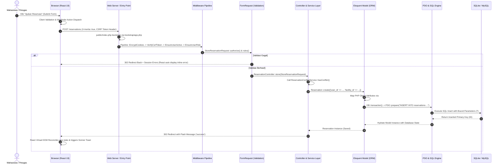

# MODUL PEMBELAJARAN ARSITEKTUR & REKAYASA PERANGKAT LUNAK: CODEBASE ADUPDF
**Dokumentasi Analisis Komprehensif Berbasis "POV Learning" untuk Studi Literatur & Rekayasa Perangkat Lunak**

---

## DAFTAR ISI
1. [Paradigma Bahasa & Komparasi Terhadap Native Trinity](#1-paradigma-bahasa--komparasi-terhadap-native-trinity)
2. [Arsitektur Makro ke Mikro & Request Lifecycle (Object to Database)](#2-arsitektur-makro-ke-mikro--request-lifecycle-object-to-database)
3. [Aspek A: Key Concept Modern Architecture](#3-aspek-a-key-concept-modern-architecture)
   - [A.1 Separation of Concerns (SoC)](#a1-separation-of-concerns-soc)
   - [A.2 Microservices Architecture](#a2-microservices-architecture)
   - [A.3 Single Page Applications (SPA)](#a3-single-page-applications-spa)
   - [A.4 Progressive Web Apps (PWA)](#a4-progressive-web-apps-pwa)
4. [Aspek B: Web Platform Security — CIA Triad](#4-aspek-b-web-platform-security--cia-triad)
   - [B.1 Confidentiality (Kerahasiaan)](#b1-confidentiality-kerahasiaan)
   - [B.2 Integrity (Integritas)](#b2-integrity-integritas)
   - [B.3 Availability (Ketersediaan)](#b3-availability-ketersediaan)
5. [Aspek C: Client-Side Scripting](#5-aspek-c-client-side-scripting)
   - [C.1 Trust Boundary](#c1-trust-boundary)
   - [C.2 Interaktivitas Halaman oleh JavaScript/TypeScript](#c2-interaktivitas-halaman-oleh-javascripttypescript)
   - [C.3 DOM: Pencarian & Manipulasi Elemen (Virtual DOM vs Direct DOM)](#c3-dom-pencarian--manipulasi-elemen-virtual-dom-vs-direct-dom)
   - [C.4 Sintaks Dasar JavaScript/TypeScript](#c4-sintaks-dasar-javascripttypescript)
   - [C.5 React to Events (Event Handling)](#c5-react-to-events-event-handling)
   - [C.6 Browser Object Model (BOM)](#c6-browser-object-model-bom)
6. [Aspek D: Server-Side Scripting & Dynamic Site](#6-aspek-d-server-side-scripting--dynamic-site)
   - [D.1.a Web Server](#d1a-web-server)
   - [D.1.b Server-Side Programming Language](#d1b-server-side-programming-language)
   - [D.1.c Database](#d1c-database)
7. [Aspek E: Fungsionalitas Server-Side Scripting (SSS)](#7-aspek-e-fungsionalitas-server-side-scripting-sss)
   - [E.1 Dynamic Webpage Generation](#e1-dynamic-webpage-generation)
   - [E.2 Database Communication & CRUD Operations](#e2-database-communication--crud-operations)
   - [E.3 Cookie Management & Lifecycle](#e3-cookie-management--lifecycle)
   - [E.4 Data Encryption, Hashing, Sanitization & Validation](#e4-data-encryption-hashing-sanitization--validation)
8. [Aspek F: Database Connection & PDO (PHP Data Objects)](#8-aspek-f-database-connection--pdo-php-data-objects)
9. [Matriks Ringkasan & Refleksi Rekayasa Codebase](#9-matriks-ringkasan--refleksi-rekayasa-codebase)

---

## 1. PARADIGMA BAHASA & KOMPARASI TERHADAP NATIVE TRINITY

Codebase AduPDF tidak dibangun dengan pola web jadul (script imperatif satu file tanpa tipe), melainkan memadukan dua ekosistem modern: **PHP 8.4** di sisi *Back-End* dan **TypeScript + React 19** di sisi *Front-End*, yang dijembatani secara monolitik modern oleh **Inertia.js**.

### A. Paradigma Bahasa di Sisi Server (PHP 8.4)
Di backend, bahasa PHP digunakan dengan paradigma:
1. **Object-Oriented Programming (OOP) Murni & Modern**:
   - Memanfaatkan *Constructor Property Promotion*, *Strict Types*, dan *Type Hinting* pada parameter serta *return types*.
   - Menggunakan fitur terbaru PHP 8 seperti **PHP Attributes** (misalnya `#[Fillable(...)]` dan `#[Hidden(...)]` pada model Eloquent).
   - Menggunakan **First-Class Backed Enums** (misalnya `ReservationStatus: string` dan `ReportStatus: string`) untuk menjamin integritas tipe nilai status di seluruh lapisan aplikasi.
2. **Declarative & Pipeline Data Processing**:
   - Penggunaan Laravel Collections, Higher-Order Messaging, dan Functional Pipelines (`map`, `filter`, `reduce`, `values`) untuk transformasi data sebelum disajikan ke frontend.

### B. Paradigma Bahasa di Sisi Klien (TypeScript & React 19)
Di frontend, bahasa JavaScript/TypeScript digunakan dengan paradigma:
1. **Component-Based Architecture**:
   - Antarmuka didekomposisi menjadi unit-unit independen, dapat digunakan kembali (*reusable*), dan terisolasi (misalnya [`UserNavbar`](file:///B:/0000_UNDIP/5.%20SMT%205/PPK_PROJECTS/AduPDF_Local/AduPDF/resources/js/components/user-navbar.tsx), [`DateCalendarGrid`](file:///B:/0000_UNDIP/5.%20SMT%205/PPK_PROJECTS/AduPDF_Local/AduPDF/resources/js/components/date-calendar-grid.tsx)).
2. **Declarative & Functional Programming**:
   - UI dideklarasikan sebagai fungsi dari *State* ($UI = f(State)$).
   - Manipulasi state menggunakan paradigma *immutability* melalui React Hooks (`useState`, `useEffect`, `useRef`, `useSyncExternalStore`).
3. **Static Strict Typing**:
   - TypeScript memvalidasi props, contracts API, dan tipe data formulir pada saat kompilasi (*compile-time checking*), mencegah kesalahan fatal *runtime* seperti `TypeError: undefined is not a function`.

### C. Komparasi Terhadap "Native Trinity" (HTML, CSS, JS Klasik)

| Dimensi | Native Trinity (HTML5, CSS3, Vanilla JS Klasik) | Pendekatan AduPDF (Laravel 12 + Inertia + React + Tailwind + TS) | Keuntungan Rekayasa di AduPDF |
| :--- | :--- | :--- | :--- |
| **Struktur Mark-up** | HTML statis (`.html`) atau file PHP template spaghetti (`echo "<div>$val</div>"`). | TSX/JSX deklaratif (`.tsx`) yang terkompilasi ke Virtual DOM React. | Komponen modular, *type-checked*, terbebas dari kesalahan sintaks tag yang tidak tertutup, *reusable*. |
| **Styling & Tampilan** | CSS global eksternal (`styles.css`) dengan risiko tabrakan nama class (*namespace collision*) dan *cascading side-effects*. | **Tailwind CSS Utility-First** yang dikompilasi oleh Vite JIT (Just-In-Time) + CSS Variables berbasis OKLCH. | Styling terikat langsung pada struktur komponen tanpa context-switching ke file CSS terpisah, bundle CSS otomatis ter-*purge* (minimalis), desain konsisten. |
| **Manipulasi DOM** | Imperatif: Pemanggilan manual via `document.getElementById('btn')`, manipulasi manual `innerHTML`, dan penambahan *event listener* manual. | Deklaratif via **React Fiber (Virtual DOM)**: Pengembang hanya mengubah *state*, dan React melakukan *reconciliation* serta *minimal batched diff update* ke real DOM. | Mengeliminasi bug *out-of-sync state*, mencegah memory leak dari event listener yang menggantung, performa rendering optimal. |
| **Alur Data & Navigasi** | *Multi-Page Application (MPA)*: Setiap klik tautan memicu *full page reload*, transfer seluruh dokumen HTML baru dari server, dan blank screen sejenak. | **Inertia.js Hybrid SPA**: Navigasi via XHR/Fetch yang hanya mentransfer JSON props, sementara shell HTML dan aset CSS/JS tetap berada di memori browser. | Pengalaman pengguna (*User Experience*) mulus secepat SPA tanpa kerumitan membangun REST API dan client-side router manual. |
| **Type Safety** | Tipe data dinamis dan longgar (loose typing). Bug tipografi properti hanya terdeteksi di browser user saat runtime. | TypeScript strict mode + PHP 8 strict types (`declare(strict_types=1)`). | Kesalahan tipe dan kontrak data terdeteksi sedini mungkin pada saat proses koding (*developer feedback loop* instan). |

---

## 2. ARSITEKTUR MAKRO KE MIKRO & REQUEST LIFECYCLE (OBJECT TO DATABASE)

### A. Level Abstrak: Arsitektur Hybrid Monolith
AduPDF menerapkan arsitektur **Modern Modular Monolith**. Aplikasi ini tidak memisahkan repo menjadi Back-End API terpisah dan Front-End SPA terpisah, melainkan menyatukannya melalui protokol **Inertia.js**:
```
+-----------------------------------------------------------------------------------+
|                                 BROWSER CLIENT                                    |
|   React 19 SPA (Virtual DOM, TypeScript, Tailwind, Wayfinder Actions, Lucide)     |
+-----------------------------------------------------------------------------------+
                                         |
                       Inertia Protocol (XHR / JSON Payload)
                                         |
+-----------------------------------------------------------------------------------+
|                           LARAVEL 12 APPLICATION CORE                             |
|  [HTTP Kernel] -> [Middleware Pipeline] -> [FormRequest Validation] -> [Router]   |
|                                         |                                         |
|  [Controller Layer] <-------------------+                                         |
|          |                                                                        |
|          +---> [Domain Services: Conflict, Availability, Impact, Recap]           |
|          |                                                                        |
|          +---> [Eloquent ORM & Query Scopes]                                      |
+-----------------------------------------------------------------------------------+
                                         |
                         PHP Data Objects (PDO Abstraction)
                                         |
+-----------------------------------------------------------------------------------+
|                        RELATIONAL DATABASE (SQLite / MySQL)                       |
|   Foreign Keys, Cascade Rules, Unique Indexes, ACID Transactions, Row Locking     |
+-----------------------------------------------------------------------------------+
```

### B. End-to-End Request Lifecycle & Alur Model (Object -> Database)
Untuk memahami bagaimana interaksi pengguna berpindah dari klik tombol di browser hingga tersimpan menjadi baris tabel biner di database, berikut alur lengkap langkah-demi-langkah:



Secara mendalam, perjalanan data ini terdiri dari 7 tahapan esensial:
1. **Representasi Klien**: Data formulir berupa JavaScript Object Literal (`{ facility_id: 1, start_time: '2026-10-15T08:00', ... }`).
2. **Serialisasi HTTP**: Dikirim melalui fetch/XHR sebagai `multipart/form-data` atau `application/json` disertai header keamanan `X-XSRF-TOKEN`.
3. **Penerimaan & Pipeline**: Laravel menangkap payload via request pool, memeriksa token CSRF, mengecek status keaktifan user (`EnsureUserActive`), dan memastikan role akun (`EnsureUserRole`).
4. **Validasi & Konstruksi Objek**: `StoreReservationRequest` memvalidasi batasan tipe data. Jika lolos, data dipetakan menjadi associative array tervalidasi (`$request->validated()`).
5. **Enkapsulasi Domain**: Controller memanggil Service layer (`ReservationConflictService`) yang melakukan pengecekan ketersediaan jadwal dengan database locking (`lockForUpdate()`).
6. **Object Relational Mapping (ORM) ke PDO**: Model `Reservation` memetakan properti PHP ke dalam kolom tabel. Eloquent mengompilasi representasi objek menjadi query SQL `INSERT INTO reservations (user_id, facility_id, ...) VALUES (?, ?, ...)` menggunakan prepared statements PDO.
7. **Persistensi Database**: Engine database menulis record ke storage disk, memicu foreign key checks, dan mengembalikan status commit transaksi.

---

## 3. ASPEK A: KEY CONCEPT MODERN ARCHITECTURE

### A.1 Separation of Concerns (SoC)

#### 1. Definisi
*Separation of Concerns (SoC)* adalah prinsip rekayasa perangkat lunak yang membagi sistem menjadi bagian-bagian berbeda, di mana setiap bagian menangani satu fokus tanggung jawab tertentu tanpa mencampuri urusan bagian lain.

#### 2. Kenapa Diterapkan
Tanpa SoC, sebuah aplikasi web akan berakhir menjadi *God Script* (misalnya satu file PHP menangani query SQL, validasi input, styling HTML, pengiriman email, dan redirect URL sekaligus). Hal ini menyebabkan kode rapuh, sulit diuji (*untestable*), dan rentan regresi saat diubah. Di AduPDF, SoC diterapkan agar:
- Lapisan HTTP (Routing & Middleware) fokus pada lalu-lintas jaringan dan autorisasi.
- Lapisan Controller fokus pada orkestrasi alur request-response.
- Lapisan Service & Query Scopes fokus pada logika bisnis murni (*business rules*).
- Lapisan Model fokus pada pemetaan entitas dan relasi database.
- Lapisan Presentasi (React) fokus pada pengalaman visual pengguna (*UI/UX rendering*).

#### 3. Struktur File / Tree yang Menerapkan SoC
```
app/
├── Http/
│   ├── Controllers/             # Lapisan Orkestrasi Request-Response
│   │   ├── ReservationController.php
│   │   └── PetugasReservationController.php
│   ├── Middleware/              # Lapisan Filter Akses & Pipeline Jaringan
│   │   ├── EnsureUserRole.php
│   │   └── EnsureUserActive.php
│   └── Requests/                # Lapisan Validasi & Autorisasi Input Pengguna
│       └── StoreReservationRequest.php
├── Models/                      # Lapisan Entitas Data & Relasi
│   ├── Facility.php
│   └── Reservation.php
├── Services/                    # Lapisan Logika Bisnis Kompleks (Domain Logic)
│   ├── FacilityAvailabilityService.php
│   └── ReservationConflictService.php
└── Queries/                     # Lapisan Optimasi Agregasi Data & Reporting
    ├── ReservationOccupancyQuery.php
    └── ReservationQueueQuery.php
resources/js/
├── pages/                       # Lapisan Tampilan Halaman (View Controller)
│   └── reservations/create.tsx
└── components/                  # Lapisan Reusable UI Atoms & Molecules
    └── date-calendar-grid.tsx
```

#### 4. Blok Kode Nyata yang Menerapkan SoC
Logika pendeteksian konflik jadwal reservasi tidak ditulis di dalam Controller atau di dalam View React, melainkan diisolasi dalam service murni di [`app/Services/ReservationConflictService.php`](file:///B:/0000_UNDIP/5.%20SMT%205/PPK_PROJECTS/AduPDF_Local/AduPDF/app/Services/ReservationConflictService.php#L13-L54):
```php
namespace App\Services;

use App\Models\Facility;
use App\Models\Reservation;
use App\Models\User;
use Carbon\CarbonInterface;
use Illuminate\Database\Eloquent\Builder;

class ReservationConflictService
{
    public function hasConflict(User $user, Facility $facility, CarbonInterface $startTime, CarbonInterface $endTime, bool $lock = false): bool
    {
        $overlapping = $this->approvedOverlaps($startTime, $endTime)
            ->where(function (Builder $query) use ($user, $facility): void {
                $query->where('user_id', $user->id);
                $this->addResourceConditions($query, $facility);
            });

        if ($lock) {
            $overlapping->lockForUpdate();
        }

        $overlapping = $overlapping->get();

        foreach ($overlapping as $reservation) {
            if ((int) $reservation->facility_id === (int) $facility->id) {
                return true;
            }
            // Penanganan hierarki peminjaman alat vs ruangan
            if ($facility->isTool() && (int) $reservation->facility_id === (int) $facility->parent_facility_id) {
                return true;
            }
            if ($facility->isRoom() && (int) $reservation->facility?->parent_facility_id === (int) $facility->id) {
                return true;
            }
        }

        return false;
    }
}
```

#### 5. Status Penerapan / Alternatif
**Diterapkan sepenuhnya**. Penerapan SoC di AduPDF bahkan diperluas dengan pemisahan query analitik yang berat ke dalam direktori [`app/Queries/`](file:///B:/0000_UNDIP/5.%20SMT%205/PPK_PROJECTS/AduPDF_Local/AduPDF/app/Queries/) (misal [`DamageStatisticsQuery`](file:///B:/0000_UNDIP/5.%20SMT%205/PPK_PROJECTS/AduPDF_Local/AduPDF/app/Queries/DamageStatisticsQuery.php)) dan pembagian rute modular di [`routes/web.php`](file:///B:/0000_UNDIP/5.%20SMT%205/PPK_PROJECTS/AduPDF_Local/AduPDF/routes/web.php#L36-L58).

---

### A.2 Microservices Architecture

#### 1. Definisi
*Microservices Architecture* adalah pendekatan arsitektur yang menstrukturkan aplikasi sebagai kumpulan layanan-layanan kecil yang independen, berjalan di prosesnya sendiri, memiliki database terpisah (*Database-per-service*), dan berkomunikasi antar-layanan melalui protokol jaringan ringan (HTTP REST, gRPC, atau message broker seperti RabbitMQ/Kafka).

#### 2. Kenapa Diterapkan / Tidak Diterapkan
**Tidak diterapkan secara terdistribusi / Diterapkan dengan cara lain dalam bentuk Modular Monolith**.
Alasan teknis rasional:
1. **Integritas Relasional ACID**: Transaksi reservasi fasilitas, pelaporan kerusakan, dan verifikasi akun civitas akademika sangat mengandalkan relasi tabel foreign key yang kuat dan *atomic rollback* (seperti `DB::transaction`). Pada microservices, transaksi terdistribusi membutuhkan mekanisme kompleks seperti *Saga Pattern* atau *Two-Phase Commit (2PC)* yang rawan *eventual consistency issues*.
2. **Overhead Operasional vs Skala Penggunaan**: Aplikasi sistem informasi fasilitas kampus beroperasi pada skala jaringan institusi kampus. Penerapan microservices akan memicu *network latency tax*, kerumitan orkestrasi kontainer (Kubernetes), dan *service discovery overhead* yang tidak proporsional bagi tim pengembang.
3. **Efisiensi Pengujian**: Kodebase monolitik memungkinkan penulisan tes end-to-end terpadu menggunakan Pest PHP (205 tes dijalankan dalam hitungan detik tanpa perlu mock jaringan eksternal).

#### 3. Struktur File / Tree yang Menerapkan Alternatif Tersebut
Sebagai ganti microservices fisik, AduPDF mengadopsi struktur **Domain-Bounded Context Monolith**:
```
app/
├── Http/Controllers/
│   ├── Admin/           # Domain Konteks Administrator Kampus
│   │   ├── AccountManagementController.php
│   │   ├── FacilityManagementController.php
│   │   └── RecapController.php
│   ├── Petugas/         # Domain Konteks Petugas Operasional (Verifikator)
│   │   ├── PetugasDashboardController.php
│   │   ├── PetugasReportController.php
│   │   └── PetugasReservationController.php
│   └──                  # Domain Konteks Pengguna Umum (Mahasiswa/Dosen)
│       ├── FacilityController.php
│       ├── ReportController.php
│       └── ReservationController.php
```

#### 4. Blok Kode Nyata yang Menerapkan Alternatif Tersebut
Modularitas internal dilakukan melalui **Modular Route Aggregation** di [`routes/web.php`](file:///B:/0000_UNDIP/5.%20SMT%205/PPK_PROJECTS/AduPDF_Local/AduPDF/routes/web.php#L36-L57):
```php
// Modular Route Aggregation (Jobdesc Section 8)
require __DIR__.'/auth.php';
require __DIR__.'/admin-accounts.php';

if (file_exists(__DIR__.'/facilities.php')) {
    require __DIR__.'/facilities.php';
}
if (file_exists(__DIR__.'/admin-facilities.php')) {
    require __DIR__.'/admin-facilities.php';
}
if (file_exists(__DIR__.'/reservations.php')) {
    require __DIR__.'/reservations.php';
}
if (file_exists(__DIR__.'/reports.php')) {
    require __DIR__.'/reports.php';
}
if (file_exists(__DIR__.'/dashboards.php')) {
    require __DIR__.'/dashboards.php';
}
if (file_exists(__DIR__.'/admin-recap.php')) {
    require __DIR__.'/admin-recap.php';
}
```

#### 5. Status Penerapan / Alternatif
**Tidak diterapkan (Microservices fisik)**. Digantikan dengan **Modular Monolith** yang memiliki pembagian domain logika terisolasi, modular routing, dan peranan otorisasi yang sangat ketat per-subdomain fungsi.

---

### A.3 Single Page Applications (SPA)

#### 1. Definisi
*Single Page Application (SPA)* adalah aplikasi web yang memuat satu dokumen HTML dasar pada kunjungan pertama, kemudian memperbarui konten halaman secara dinamis melalui interaksi JavaScript dan transfer data (JSON) di latar belakang tanpa pernah memuat ulang (*reloading*) seluruh halaman web.

#### 2. Kenapa Diterapkan
AduPDF memerlukan pengalaman pengguna yang sangat responsif, terutama pada fitur interaktif seperti pemilihan jadwal kalender interaktif, filter daftar fasilitas *real-time*, dan konfirmasi dialog tanpa kedipan layar (*screen flickering*). SPA diterapkan untuk:
- Mengeliminasi *white flash* saat perpindahan rute antar halaman.
- Mempertahankan memori status sisi klien (misalnya state formulir sementara, preferensi tema gelap/terang, dan status filter).
- Menghemat konsumsi bandwidth jaringan: server hanya mengirim payload JSON murni berisi data reservasi/fasilitas, bukan markup HTML lengkap berulang kali.

#### 3. Struktur File / Tree yang Menerapkan SPA
```
resources/
├── views/
│   └── app.blade.php           # Single HTML Shell Host (<x-inertia::app />)
└── js/
    ├── app.tsx                 # Client Entry Point pemrakarsa createInertiaApp
    ├── pages/                  # Komponen-komponen SPA yang dimuat secara dinamis
    │   ├── facilities/index.tsx
    │   ├── facilities/show.tsx
    │   └── reservations/create.tsx
    └── components/
        └── user-navbar.tsx     # Komponen navigasi yang menggunakan komponen <Link>
```

#### 4. Blok Kode Nyata yang Menerapkan SPA
1. Host Shell tunggal di [`resources/views/app.blade.php`](file:///B:/0000_UNDIP/5.%20SMT%205/PPK_PROJECTS/AduPDF_Local/AduPDF/resources/views/app.blade.php#L43-L56):
```blade
        @viteReactRefresh
        @vite(['resources/css/app.css', 'resources/js/app.tsx', "resources/js/pages/{$page['component']}.tsx"])
    </head>
    <body class="font-sans antialiased">
        <x-inertia::app />
    </body>
</html>
```

2. Titik inisialisasi SPA di [`resources/js/app.tsx`](file:///B:/0000_UNDIP/5.%20SMT%205/PPK_PROJECTS/AduPDF_Local/AduPDF/resources/js/app.tsx#L7-L21):
```typescript
void createInertiaApp({
    title: (title) => (title ? `${title} - ${appName}` : appName),
    strictMode: true,
    withApp(app) {
        return (
            <>
                {app}
                <Toaster />
            </>
        );
    },
    progress: {
        color: '#4B5563',
    },
});
```

3. Navigasi SPA tanpa reload di komponen navigasi [`resources/js/components/user-navbar.tsx`](file:///B:/0000_UNDIP/5.%20SMT%205/PPK_PROJECTS/AduPDF_Local/AduPDF/resources/js/components/user-navbar.tsx#L1-L20):
```tsx
import { Link } from '@inertiajs/react';

// Penggunaan komponen <Link> mencegah default browser full-reload:
<Link
    href="/facilities"
    className="text-sm font-medium text-slate-700 hover:text-blue-600 transition-colors"
>
    Daftar Fasilitas
</Link>
```

#### 5. Status Penerapan / Alternatif
**Diterapkan sepenuhnya**. Diterapkan dengan pola **Modern Hybrid SPA via Inertia.js**, di mana routing didefinisikan secara deklaratif di backend Laravel (`routes/web.php`) sementara eksekusi pergantian halaman di browser ditangani sebagai SPA oleh React 19.

---

### A.4 Progressive Web Apps (PWA)

#### 1. Definisi
*Progressive Web Apps (PWA)* adalah aplikasi web yang memanfaatkan kapabilitas web modern (termasuk *Web App Manifest*, *Service Workers*, dan *Cache Storage API*) untuk memberikan kapabilitas setara aplikasi natif, seperti kemampuan diinstal ke layar beranda (*installability*), berjalan offline, serta menerima notifikasi *push*.

#### 2. Kenapa Diterapkan / Tidak Diterapkan
**Tidak diterapkan**.
Alasan teknis rasional:
1. **Kebutuhan Konsistensi Data Real-Time**: Sistem reservasi ruangan dan alat laboratorium membutuhkan sinkronisasi waktu dan status ruangan yang mutlak akurat (*strict real-time validation*). Menyimpan reservasi di cache offline berisiko menimbulkan konflik ganda (*double booking*) saat pengguna lain mereservasi ruangan yang sama pada detik yang bersamaan.
2. **Ketiadaan Service Worker & Web App Manifest**: Codebase AduPDF tidak menyertakan file `manifest.json` maupun registrasi `navigator.serviceWorker.register()` di sisi frontend.
3. **Fokus pada Standar Web Responsif**: AduPDF dirancang sebagai *Responsive Web Application* yang diakses melalui browser desktop dan mobile civitas akademika tanpa dependensi pada layer offline caching PWA.

#### 3. Struktur File / Tree Terkait
Pemeriksaan aset frontend membuktikan ketiadaan manifest PWA:
```
public/
├── favicon.ico
├── favicon.svg
├── apple-touch-icon.png
└── robots.txt
# (TIDAK ADA file manifest.webmanifest atau sw.js di folder public maupun resources)
```

#### 4. Blok Kode Bukti Tidak Diterapkannya PWA
Di [`resources/views/app.blade.php`](file:///B:/0000_UNDIP/5.%20SMT%205/PPK_PROJECTS/AduPDF_Local/AduPDF/resources/views/app.blade.php#L33-L37), hanya didefinisikan favicon standar, tanpa relasi manifest:
```blade
<link rel="icon" type="image/x-icon" href="/favicon.ico">
<link rel="icon" type="image/png" sizes="32x32" href="/favicon-32x32.png">
<link rel="icon" type="image/png" sizes="16x16" href="/favicon-16x16.png">
<link rel="icon" type="image/svg+xml" href="/favicon.svg?v=4">
<link rel="apple-touch-icon" sizes="180x180" href="/apple-touch-icon.png">
{{-- Ketiadaan tag: <link rel="manifest" href="/manifest.json"> --}}
```

#### 5. Status Penerapan / Alternatif
**Tidak diterapkan**. Sebagai alternatifnya, aplikasi dibangun dengan arsitektur **Mobile-Responsive SPA** yang dioptimalkan dengan pemuatan aset cepat melalui Vite, server response yang ramping, dan penanganan konektivitas berbasis standard HTTP.

---

## 4. ASPEK B: WEB PLATFORM SECURITY: THE CIA TRIAD

Dalam keamanan sistem informasi, **CIA Triad** (Confidentiality, Integrity, Availability) merupakan standar emas untuk mengevaluasi postur keamanan. Di AduPDF, seluruh pilar ini diterapkan secara ketat.

```
+-----------------------------------------------------------------------------------+
|                                  THE CIA TRIAD                                    |
+-----------------------------------------------------------------------------------+
| [C] CONFIDENTIALITY  | Bcrypt Hashing, Encrypted Sessions, Role-based Middleware   |
|                      | Protected Storage Paths, ID Obfuscation / Scope Isolation   |
+----------------------+------------------------------------------------------------+
| [I] INTEGRITY        | CSRF Tokens, PDO Prepared Statements, Foreign Key Cascades  |
|                      | DB Transactions, FormRequest Strict Validation Schemas     |
+----------------------+------------------------------------------------------------+
| [A] AVAILABILITY     | Rate Limiting (Throttle Middleware), Cron Expiration Auto, |
|                      | Soft Deletes (Zero NullPointer Crash), DB Pessimistic Locks |
+-----------------------------------------------------------------------------------+
```

### B.1 Confidentiality (Kerahasiaan Data & Akses)

#### 1. Definisi
*Confidentiality* menjamin bahwa data sensitif dan hak akses hanya dapat dilihat atau diakses oleh pihak yang berhak (*authorized entities*) dan terlindungi dari kebocoran (*data leakage*) kepada pihak yang tidak berwenang.

#### 2. Kenapa Diterapkan
AduPDF mengelola data kredensial mahasiswa, identitas institusional (NIM/NIP), nomor kontak WhatsApp, serta berkas laporan kerusakan internal. Kebocoran data akan melanggar privasi civitas akademika dan berisiko eksploitasi identitas.

#### 3. Struktur File / Tree yang Menerapkan Kerahasiaan
```
app/
├── Models/User.php                                  # Proteksi Atribut Sensitif (#[Hidden]) & Hashing
├── Http/Middleware/EnsureUserRole.php               # Isolasi Akses Berbasis Role (RBAC)
└── Http/Controllers/ReportAttachmentController.php  # Proteksi Unduhan Berkas Privat
```

#### 4. Blok Kode Nyata yang Menerapkan Kerahasiaan
1. Penyembunyian atribut kredensial dari serialisasi JSON dan auto-hashing di [`app/Models/User.php`](file:///B:/0000_UNDIP/5.%20SMT%205/PPK_PROJECTS/AduPDF_Local/AduPDF/app/Models/User.php#L36-L59):
```php
#[Fillable(['nama', 'name', 'email', 'password', 'role', 'institutional_id', 'identity_type', 'whatsapp'])]
#[Hidden(['password', 'two_factor_secret', 'two_factor_recovery_codes', 'remember_token', 'approved_by'])]
class User extends Authenticatable implements PasskeyUser
{
    protected function casts(): array
    {
        return [
            'password' => 'hashed', // Menggunakan Bcrypt / Argon2 otomatis
            // ...
        ];
    }
}
```

2. Pengecekan otorisasi kepemilikan data sebelum melihat atau mengunduh di [`app/Http/Controllers/ReportController.php`](file:///B:/0000_UNDIP/5.%20SMT%205/PPK_PROJECTS/AduPDF_Local/AduPDF/app/Http/Controllers/ReportController.php#L87-L90):
```php
private function ensureOwner(Request $request, Report $report): void
{
    // Mencegah insiden IDOR (Insecure Direct Object Reference)
    abort_unless((int) $report->user_id === (int) $request->user()->id, 403);
}
```

#### 5. Status Penerapan / Alternatif
**Diterapkan sepenuhnya**. Menggunakan kombinasi atribut model `#[Hidden]`, enkripsi cookie otomatis di [`bootstrap/app.php`](file:///B:/0000_UNDIP/5.%20SMT%205/PPK_PROJECTS/AduPDF_Local/AduPDF/bootstrap/app.php#L26), dan proteksi rute berbasis role.

---

### B.2 Integrity (Integritas Data & Transaksi)

#### 1. Definisi
*Integrity* menjamin bahwa data dan alur transaksi sistem tetap akurat, konsisten, tidak dapat dimanipulasi secara ilegal, dan terbebas dari modifikasi tanpa izin selama masa penyimpanan maupun transmisi jaringan.

#### 2. Kenapa Diterapkan
Peminjaman fasilitas kampus menyangkut kepastian jadwal ruang kelas dan alat praktikum bernilai tinggi. Jika terjadi manipulasi data reservasi (misal *race condition* atau pemalsuan parameter POST), dua pihak bisa mengklaim ruangan yang sama, merusak jadwal akademik kampus.

#### 3. Struktur File / Tree yang Menerapkan Integritas
```
app/
├── Http/Requests/StoreReservationRequest.php        # Validasi Integritas Input Komprehensif
├── Services/ReservationConflictService.php          # Database Locking (Pessimistic Lock)
└── database/migrations/                             # Skema Integritas Relasional
    └── 2026_09_17_000000_create_reservations_table.php
```

#### 4. Blok Kode Nyata yang Menerapkan Integritas
1. Penggunaan `DB::transaction` untuk menjamin sifat ACID (Atomicity, Consistency, Isolation, Durability) saat input reservasi berulang di [`app/Http/Controllers/ReservationController.php`](file:///B:/0000_UNDIP/5.%20SMT%205/PPK_PROJECTS/AduPDF_Local/AduPDF/app/Http/Controllers/ReservationController.php#L56-L68):
```php
if (is_array($schedules) && count($schedules) > 0) {
    DB::transaction(function () use ($request, $input, $schedules) {
        foreach ($schedules as $sched) {
            Reservation::create([
                'user_id' => $request->user()->id,
                'facility_id' => $input['facility_id'],
                'tujuan' => $input['tujuan'],
                'start_time' => CarbonImmutable::parse("{$sched['date']}T{$sched['start_time']}", 'Asia/Jakarta')->utc()->format('Y-m-d H:i:s'),
                'end_time' => CarbonImmutable::parse("{$sched['date']}T{$sched['end_time']}", 'Asia/Jakarta')->utc()->format('Y-m-d H:i:s'),
                'status' => ReservationStatus::Pending,
            ]);
        }
    });
}
```

2. Integritas Relasi Foreign Key di database migration [`database/migrations/2026_09_17_000000_create_reservations_table.php`](file:///B:/0000_UNDIP/5.%20SMT%205/PPK_PROJECTS/AduPDF_Local/AduPDF/database/migrations/2026_09_17_000000_create_reservations_table.php#L16-L17):
```php
$table->foreignId('user_id')->constrained();
$table->foreignId('facility_id')->constrained();
```
Menjamin bahwa tidak akan pernah ada data reservasi yang merujuk pada `user_id` atau `facility_id` yang tidak valid.

#### 5. Status Penerapan / Alternatif
**Diterapkan sepenuhnya**. Diperkuat dengan token CSRF (`X-XSRF-TOKEN`), sanitasi input, validasi skema form request, dan constraint database level engine.

---

### B.3 Availability (Ketersediaan Layanan)

#### 1. Definisi
*Availability* menjamin bahwa sistem, aplikasi, dan data tetap dapat diakses dan berfungsi sebagaimana mestinya oleh pengguna yang sah kapan pun dibutuhkan, tanpa mengalami *downtime*, kemacetan query, atau crash tak terkendali.

#### 2. Kenapa Diterapkan
Sistem fasilitas kampus diakses secara bersamaan oleh ratusan mahasiswa pada periode tertentu (misalnya awal semester atau sebelum praktikum). Jika ada antrean query yang menumpuk karena data kadaluarsa yang menggantung, antrean petugas verifikasi akan melambat atau aplikasi mengalami DoS (*Denial of Service*).

#### 3. Struktur File / Tree yang Menerapkan Ketersediaan
```
bootstrap/app.php           # Konfigurasi Task Scheduler Otomatis
routes/console.php          # Command Otomatis Pembersihan Data Kedaluwarsa
app/Models/User.php         # Soft Deletes (Pencegahan Cascade Crash)
```

#### 4. Blok Kode Nyata yang Menerapkan Ketersediaan
1. Penjadwalan *Automated Expiration Cleaner* setiap menit di [`bootstrap/app.php`](file:///B:/0000_UNDIP/5.%20SMT%205/PPK_PROJECTS/AduPDF_Local/AduPDF/bootstrap/app.php#L21-L23):
```php
    ->withSchedule(function (Schedule $schedule): void {
        $schedule->command('reservations:expire')->everyMinute();
    })
```

2. Logika pembersihan otomatis reservasi menggantung di [`routes/console.php`](file:///B:/0000_UNDIP/5.%20SMT%205/PPK_PROJECTS/AduPDF_Local/AduPDF/routes/console.php#L15-L29):
```php
Artisan::command('reservations:expire', function (): void {
    $rejectedAt = now();
    $rejectionReason = 'Pengajuan ditolak otomatis karena belum disetujui hingga waktu reservasi dimulai (kedaluwarsa).';

    $count = Reservation::query()
        ->where('status', ReservationStatus::Pending->value)
        ->where('start_time', '<=', $rejectedAt)
        ->update([
            'status' => ReservationStatus::Rejected->value,
            'alasan_penolakan' => $rejectionReason,
            'ditolak_pada' => $rejectedAt,
        ]);

    $this->info("{$count} pending reservations rejected because their start time arrived.");
})->purpose('Reject pending reservations when their start time arrives');
```
Kode ini mencegah akumulasi status *pending* yang telah lewat waktu agar antrean verifikasi petugas tetap bersih dan kapasitas ruangan kembali tersedia secara otomatis.

3. Penerapan `SoftDeletes` di model [`app/Models/User.php`](file:///B:/0000_UNDIP/5.%20SMT%205/PPK_PROJECTS/AduPDF_Local/AduPDF/app/Models/User.php#L41):
Menghindari error `Foreign key constraint fails` atau `NullPointerException` pada data historis saat seorang user dinonaktifkan oleh administrator.

#### 5. Status Penerapan / Alternatif
**Diterapkan sepenuhnya**. Diperkuat dengan health check endpoint `/up` di [`bootstrap/app.php`](file:///B:/0000_UNDIP/5.%20SMT%205/PPK_PROJECTS/AduPDF_Local/AduPDF/bootstrap/app.php#L19) untuk pemantauan ketersediaan oleh load balancer atau *uptime monitor*.

---

## 5. ASPEK C: CLIENT-SIDE SCRIPTING

### C.1 Trust Boundary

#### 1. Definisi
*Trust Boundary* (Batas Kepercayaan) adalah batas arsitektural yang memisahkan komponen sistem yang dapat dipercaya (*trusted zone*, yaitu Server) dari komponen yang tidak dapat dipercaya (*untrusted zone*, yaitu Client Browser). Prinsip fundamentalnya: **Klien browser sepenuhnya berada di bawah kendali pengguna, sehingga input klien tidak boleh dipercaya secara mutlak.**

#### 2. Kenapa Diterapkan
Pengguna dapat memanipulasi JavaScript klien melalui DevTools, mengubah DOM elemen, menonaktifkan atribut `disabled` tombol, atau mengirim request langsung via `curl`/Postman. Di AduPDF, validasi ganda diterapkan:
- Frontend melakukan validasi untuk kenyamanan antarmuka (*immediate UX feedback*).
- Backend melakukan validasi dan otorisasi otoritatif mutlak (*authoritative gatekeeper*).

#### 3. Struktur File / Tree yang Menerapkan Trust Boundary
```
resources/js/pages/reservations/create.tsx      # Sisi Klien (Untrusted UX layer)
app/Http/Requests/StoreReservationRequest.php    # Sisi Server (Authoritative Gatekeeper)
```

#### 4. Blok Kode Nyata yang Menerapkan Trust Boundary
Meskipun di sisi klien browser telah ada pemeriksaan jam operasional di React, server tetap memverifikasi ulang seluruh aturan bisnis di [`app/Http/Requests/StoreReservationRequest.php`](file:///B:/0000_UNDIP/5.%20SMT%205/PPK_PROJECTS/AduPDF_Local/AduPDF/app/Http/Requests/StoreReservationRequest.php#L14-L21 dan #L50-L54):
```php
public function authorize(): bool
{
    $user = $this->user();

    // Server secara independen memeriksa status keaktifan user
    return $user?->isPengguna() === true
        && $user->isActive()
        && $user->isApproved();
}

// Pemeriksaan aturan domain di server:
if (! app(FacilityConditionService::class)->isReservable($facility)) {
    $validator->errors()->add('facility_id', 'Fasilitas ini tidak dapat direservasi.');
    return;
}
```

#### 5. Status Penerapan / Alternatif
**Diterapkan sepenuhnya**. Penerapan batas kepercayaan di AduPDF menjamin integritas data meskipun client-side scripting dimatikan atau diretas oleh pengguna.

---

### C.2 Interaktivitas Halaman oleh JavaScript/TypeScript

#### 1. Definisi
Interaktivitas halaman adalah kemampuan halaman web merespons aksi pengguna secara langsung (klik, ketikan, perubahan pilihan) dengan memperbarui representasi visual, melakukan kalkulasi lokal, atau memicu animasi tanpa perlu me-reload halaman dari server.

#### 2. Kenapa Diterapkan
Pada form pengajuan reservasi di AduPDF, pengguna membutuhkan feedback instan saat memilih jam mulai dan jam selesai, seperti:
- Durasi otomatis terhitung (misalnya "1 Jam 30 Menit").
- Slot jam selesai yang tidak valid langsung dinonaktifkan.
- Kalender menampilkan slot tanggal yang sudah lewat hari sebagai *disabled*.

#### 3. Struktur File / Tree yang Menerapkan Interaktivitas
```
resources/js/
├── pages/reservations/create.tsx       # State manajemen kalkulasi slot waktu & durasi
├── components/date-calendar-grid.tsx   # Grid kalender interaktif dinamis
└── components/confirm-dialog.tsx       # Modal konfirmasi aksi destruktif
```

#### 4. Blok Kode Nyata Interaktivitas
Kalkulasi dinamis durasi reservasi dan parsing slot waktu secara instan di [`resources/js/pages/reservations/create.tsx`](file:///B:/0000_UNDIP/5.%20SMT%205/PPK_PROJECTS/AduPDF_Local/AduPDF/resources/js/pages/reservations/create.tsx#L50-L58):
```typescript
function formatDuration(start: string, end: string): string {
    const [sh, sm] = start.split(':').map(Number);
    const [eh, em] = end.split(':').map(Number);
    const minutes = (eh * 60 + em) - (sh * 60 + sm);
    if (isNaN(minutes) || minutes <= 0) return '';
    if (minutes < 60) return `${minutes} Menit`;
    const hours = minutes / 60;
    return `${hours.toString().replace('.', ',')} Jam`;
}
```
Ketika pengguna mengganti pilihan dropdown, fungsi ini langsung menghasilkan string durasi di samping input formulir secara reaktif.

#### 5. Status Penerapan / Alternatif
**Diterapkan sepenuhnya**. Menggunakan TypeScript dan React Hooks reaktif untuk menyajikan antarmuka modern yang interaktif.

---

### C.3 DOM: Pencarian & Manipulasi Elemen (Virtual DOM vs Direct DOM)

#### 1. Definisi
*Document Object Model (DOM)* adalah representasi pohon objek terstruktur dari dokumen HTML di memori browser. Manipulasi DOM klasik menggunakan API native (`document.querySelector`, `element.appendChild`), sedangkan manipulasi modern di React menggunakan **Virtual DOM (VDOM)**, yaitu representasi pohon virtual di memori JavaScript di mana React melakukan *diffing algorithm* dan hanya mengaplikasikan perubahan minimum ke *Real DOM* browser.

#### 2. Kenapa Diterapkan
Manipulasi Real DOM secara manual sangat mahal (*expensive*) dari segi performa CPU karena setiap modifikasi atribut/node memicu proses *Reflow* (perhitungan geometri layout) dan *Repaint* (penggambaran piksel ulang layar). Dengan React 19 di AduPDF:
- Seluruh manipulasi struktur tabel, list fasilitas, dan modal ditangani secara deklaratif via JSX.
- Manipulasi Real DOM langsung diminimalisir dan hanya digunakan pada area yang memerlukan integrasi native (misalnya pengubahan kelas root tema `<html class="dark">`).

#### 3. Struktur File / Tree yang Menerapkan
```
resources/js/
├── pages/facilities/index.tsx      # Komponen Deklaratif Virtual DOM
└── hooks/use-appearance.tsx        # Contoh Khusus Akses Direct Real DOM
```

#### 4. Blok Kode Nyata
1. **Pendekatan Deklaratif (Virtual DOM)** di [`resources/js/pages/facilities/index.tsx`](file:///B:/0000_UNDIP/5.%20SMT%205/PPK_PROJECTS/AduPDF_Local/AduPDF/resources/js/pages/facilities/index.tsx):
Alih-alih menulis `document.getElementById('list').innerHTML += ...`, pengembang menulis JSX:
```tsx
<div className="grid grid-cols-1 md:grid-cols-2 lg:grid-cols-3 gap-6">
    {facilities.map((facility) => (
        <FacilityCard key={facility.id} facility={facility} />
    ))}
</div>
```

2. **Pendekatan Direct DOM Manipulation (Kebutuhan Sistem Khusus)** di [`resources/js/hooks/use-appearance.tsx`](file:///B:/0000_UNDIP/5.%20SMT%205/PPK_PROJECTS/AduPDF_Local/AduPDF/resources/js/hooks/use-appearance.tsx#L44-L53):
```typescript
const applyTheme = (appearance: Appearance): void => {
    if (typeof document === 'undefined') {
        return;
    }

    const isDark = isDarkMode(appearance);

    // Manipulasi langsung ke Root Element Real DOM untuk dark mode
    document.documentElement.classList.toggle('dark', isDark);
    document.documentElement.style.colorScheme = isDark ? 'dark' : 'light';
};
```

#### 5. Status Penerapan / Alternatif
**Diterapkan dengan cara lain**. Secara default menggunakan abstraksi **React Virtual DOM** untuk perenderaan komponen UI, dan menggunakan **Direct DOM API** (`document.documentElement`) secara selektif hanya saat menyetel preferensi tema global.

---

### C.4 Sintaks Dasar JavaScript/TypeScript

#### 1. Definisi
Sintaks dasar mencakup konstruksi bahasa inti untuk logika pemrograman: deklarasi variabel (`const`, `let`), struktur kondisional (`if/else`, ternary `? :`), struktur perulangan/iterasi (`for`, `map`, `forEach`), serta pendefinisian fungsi (*arrow functions*, *typed functions*).

#### 2. Kenapa Diterapkan
Merupakan blok bangunan fundamental (*fundamental building blocks*) untuk menulis logika validasi, transformasi data, dan pengendalian alur eksekusi aplikasi di browser.

#### 3. Struktur File / Tree yang Menerapkan
```
resources/js/pages/reservations/create.tsx
resources/js/hooks/use-appearance.tsx
```

#### 4. Blok Kode Nyata Sintaks Dasar
Cuplikan representatif dari [`resources/js/pages/reservations/create.tsx`](file:///B:/0000_UNDIP/5.%20SMT%205/PPK_PROJECTS/AduPDF_Local/AduPDF/resources/js/pages/reservations/create.tsx#L27-L32 dan #L71-L80):
```typescript
// 1. Variabel & Perulangan / Array Generation:
const timeOptions = Array.from({ length: 27 }, (_, index) => {
    const minutes = 7 * 60 + index * 30; // Variabel konstanta & operasi aritmatika
    return `${String(Math.floor(minutes / 60)).padStart(2, '0')}:${String(minutes % 60).padStart(2, '0')}`;
});

// 2. Kondisional (if-else & ternary):
const minimumStartTime = nextWibSlot(currentWib.time);
const todayUnavailable = minimumStartTime > '19:30';
const firstReservableDateValue = new Date(`${currentWib.date}T00:00:00Z`);

if (todayUnavailable) {
    firstReservableDateValue.setUTCDate(firstReservableDateValue.getUTCDate() + 1);
}

// 3. Fungsi & Destructuring Typed Signature:
function currentWibDateTime(reference: Date = new Date()): { date: string; time: string } {
    const parts = Object.fromEntries(
        wibDateTimeFormatter.formatToParts(reference).map(({ type, value }) => [type, value])
    ) as Record<string, string>;

    return {
        date: `${parts.year}-${parts.month}-${parts.day}`,
        time: `${parts.hour}:${parts.minute}`,
    };
}
```

#### 5. Status Penerapan / Alternatif
**Diterapkan sepenuhnya**. Menggunakan standar modern ECMAScript (ES2022+) dengan *strict static typing* dari TypeScript.

---

### C.5 React to Events (Event Handling)

#### 1. Definisi
*Event Handling* adalah mekanisme di mana aplikasi web menangkap dan merespons sinyal/peristiwa yang terjadi di browser, seperti penekanan tombol (*click*), pengiriman formulir (*submit*), perubahan input (*change*), atau pergerakan kursor (*hover*).

#### 2. Kenapa Diterapkan
Aplikasi web tidak akan bernyawa tanpa event listener. Di AduPDF, event handling digunakan untuk:
- Mencegah perilaku default browser (*prevent reload* saat submit formulir via `e.preventDefault()`).
- Menangkap input teks pengguna dan memperbarui state formulir secara reaktif.
- Membuka modal konfirmasi sebelum aksi pembatalan reservasi dikirim ke server.

#### 3. Struktur File / Tree yang Menerapkan
```
resources/js/components/confirm-dialog.tsx
resources/js/pages/reservations/create.tsx
resources/js/pages/facilities/show.tsx
```

#### 4. Blok Kode Nyata Event Handling
Contoh penanganan event `onSubmit` dan `onClick` di [`resources/js/components/confirm-dialog.tsx`](file:///B:/0000_UNDIP/5.%20SMT%205/PPK_PROJECTS/AduPDF_Local/AduPDF/resources/js/components/confirm-dialog.tsx#L25-L45):
```tsx
<form
    onSubmit={(e) => {
        e.preventDefault(); // Mencegah reload halaman standar browser
        onConfirm();        // Eksekusi callback konfirmasi
    }}
>
    <button
        type="button"
        onClick={onClose}   // Event click untuk menutup dialog
        className="px-4 py-2 border rounded-lg hover:bg-slate-50"
    >
        Batal
    </button>
    <button
        type="submit"
        className="px-4 py-2 bg-red-600 text-white rounded-lg hover:bg-red-700"
    >
        Ya, Lanjutkan
    </button>
</form>
```

#### 5. Status Penerapan / Alternatif
**Diterapkan sepenuhnya**. Menggunakan *Synthetic Event System* dari React (`onClick`, `onSubmit`, `onChange`) yang dinormalisasi di seluruh browser untuk menjamin kompatibilitas silang (*cross-browser consistency*).

---

### C.6 Browser Object Model (BOM)

#### 1. Definisi
*Browser Object Model (BOM)* adalah antarmuka pemrograman yang disediakan browser untuk berinteraksi dengan objek lingkungan di luar dokumen halaman web itu sendiri. Objek BOM mencakup `window`, `navigator`, `location`, `history`, `screen`, dan manipulasi cookie `document.cookie`.

#### 2. Kenapa Diterapkan
Aplikasi web perlu membaca parameter query dari URL address bar, berinteraksi dengan preferensi media browser pengguna (*dark mode detection*), dan menyimpan state sementara di cookie browser.

#### 3. Struktur File / Tree yang Menerapkan BOM
```
resources/js/hooks/use-appearance.tsx           # window.matchMedia & document.cookie
resources/js/pages/reservations/create.tsx      # window.location & URLSearchParams
resources/js/pages/settings/profile.tsx         # document.cookie parsing
```

#### 4. Blok Kode Nyata Pemanfaatan BOM
1. Membaca Query Params URL melalui `window.location` di [`resources/js/pages/reservations/create.tsx`](file:///B:/0000_UNDIP/5.%20SMT%205/PPK_PROJECTS/AduPDF_Local/AduPDF/resources/js/pages/reservations/create.tsx#L86-L90):
```typescript
const searchString = url.includes('?') 
    ? url.split('?')[1] 
    : (typeof window !== 'undefined' ? window.location.search.replace(/^\?/, '') : '');

const params = new URLSearchParams(searchString);
const requestedStart = params.get('start_time') ?? '';
```

2. Membaca dan mem-parsing Cookie klien di [`resources/js/pages/settings/profile.tsx`](file:///B:/0000_UNDIP/5.%20SMT%205/PPK_PROJECTS/AduPDF_Local/AduPDF/resources/js/pages/settings/profile.tsx#L47-L54):
```typescript
if (typeof document === 'undefined') return null;

// Mengakses document.cookie BOM API dan regex parsing
const match = document.cookie.match(/(?:^|; )pending_reservation=([^;]*)/);
if (!match) return null;
try {
    return JSON.parse(decodeURIComponent(match[1]));
} catch {
    return null;
}
```

3. Deteksi preferensi OS via BOM `window.matchMedia` di [`resources/js/hooks/use-appearance.tsx`](file:///B:/0000_UNDIP/5.%20SMT%205/PPK_PROJECTS/AduPDF_Local/AduPDF/resources/js/hooks/use-appearance.tsx#L15-L21):
```typescript
const prefersDark = (): boolean => {
    if (typeof window === 'undefined') {
        return false;
    }

    return window.matchMedia('(prefers-color-scheme: dark)').matches;
};
```

#### 5. Status Penerapan / Alternatif
**Diterapkan sepenuhnya**. Diimplementasikan dengan pola *defensive check* (`typeof window !== 'undefined'`) untuk mencegah error ketika kode dieksekusi di lingkungan tanpa DOM/BOM (seperti SSR atau node build pipeline).

---

## 6. ASPEK D: SERVER-SIDE SCRIPTING & DYNAMIC SITE

Situs dinamis (*Dynamic Site*) adalah situs web yang menghasilkan konten halaman secara dinamis pada saat ada permintaan (*on-demand*) dari klien, dengan mengambil dan mengolah data dari database melalui bahasa pemrograman server.

```
+-----------------------------------------------------------------------------------+
|                        DYNAMIC SITE THREE-TIER INFRASTRUCTURE                     |
+-----------------------------------------------------------------------------------+
| 1. WEB SERVER GATEWAY  | Nginx / Apache / PHP Built-in (Port 8000)                |
|                        | Menangani Socket TCP, SSL/TLS, Static Assets, FastCGI    |
+------------------------+----------------------------------------------------------+
| 2. SSS RUNTIME         | PHP 8.4 Engine (Zend VM, Opcache, Request Worker)        |
|                        | Mengeksekusi framework Laravel, Autoloading, Logika Bisnis |
+------------------------+----------------------------------------------------------+
| 3. DATABASE ENGINE     | SQLite / MySQL RDBMS (ACID, B-Tree Indexes, Storage Disk)|
|                        | Menyimpan data persisten tabel users, facilities, dll.   |
+-----------------------------------------------------------------------------------+
```

### D.1.a Web Server

#### 1. Definisi
Web server adalah perangkat lunak (seperti Nginx, Apache HTTP Server, atau PHP Built-in Server) yang mendengarkan request HTTP pada port tertentu, melayani berkas statis (gambar, JS, CSS) secara langsung, dan meneruskan request dinamis ke runtime server-side scripting melalui protokol FastCGI/PHP-FPM.

#### 2. Kenapa Diterapkan
Browser klien tidak bisa berdialog langsung dengan file skrip PHP. Web server bertindak sebagai pintu gerbang (*front-door proxy*) yang mengisolasi jaringan publik, mengatur SSL/TLS termination, dan meneruskan request masuk ke entry point tunggal aplikasi (`public/index.php`).

#### 3. Struktur File / Tree Terkait
```
public/
├── index.php               # Single Entry Point yang dipanggil oleh Web Server
├── .htaccess               # Konfigurasi rewrite rules untuk Apache Web Server
├── robots.txt              # Berkas instruksi crawler untuk Web Server
└── favicon.ico             # Berkas aset statis yang disajikan langsung oleh Web Server
```

#### 4. Blok Kode Nyata Konfigurasi Web Server
File rewrite rule web server di [`public/.htaccess`](file:///B:/0000_UNDIP/5.%20SMT%205/PPK_PROJECTS/AduPDF_Local/AduPDF/public/.htaccess):
```apache
<IfModule mod_rewrite.c>
    RewriteEngine On
    # Jika berkas statis ada di disk, Web Server langsung menyajikannya:
    RewriteCond %{REQUEST_FILENAME} !-d
    RewriteCond %{REQUEST_FILENAME} !-f
    # Jika tidak ada, arahkan request ke index.php:
    RewriteRule ^ index.php [L]
</IfModule>
```
Dan kode entry point di [`public/index.php`](file:///B:/0000_UNDIP/5.%20SMT%205/PPK_PROJECTS/AduPDF_Local/AduPDF/public/index.php#L13-L22):
```php
// Menentukan titik mulai benchmark memori & waktu
define('LARAVEL_START', microtime(true));

// Memuat Autoloader Composer
require __DIR__.'/../vendor/autoload.php';

// Memulai bootstrap aplikasi dan menangani request yang masuk
(require_once __DIR__.'/../bootstrap/app.php')
    ->handleRequest(Request::capture());
```

#### 5. Status Penerapan / Alternatif
**Diterapkan sepenuhnya**. Di lingkungan lokal dijalankan via PHP Built-in Web Server / Laravel Artisan (`php artisan serve`), dan di lingkungan produksi diarahkan ke Nginx dengan socket PHP-FPM.

---

### D.1.b Server-Side Programming Language

#### 1. Definisi
Bahasa pemrograman sisi server adalah bahasa yang dieksekusi di lingkungan server (bukan di browser pengguna) untuk memproses logika bisnis, berinteraksi dengan sistem berkas dan database, serta menghasilkan respon HTTP.

#### 2. Kenapa Diterapkan
PHP 8.4 dipilih sebagai runtime server AduPDF karena:
- Waktu booting cepat (*fast execution lifecycle* per-request).
- Sistem tipe yang matang (*strong typing system*).
- Dukungan luas untuk library enkripsi, pengolahan file PDF, dan driver basis data.
- Menjamin keamanan kode: seluruh rahasia konfigurasi (kunci enkripsi, password database) tersimpan aman di server dan tidak pernah terekspos ke klien.

#### 3. Struktur File / Tree Terkait
```
composer.json               # Deklarasi Persyaratan Engine PHP
bootstrap/app.php           # Konfigurasi Inisialisasi Runtime
app/Providers/              # Service Providers pengatur lifecycle PHP
```

#### 4. Blok Kode Nyata Spesifikasi & Eksekusi Bahasa
Persyaratan bahasa di [`composer.json`](file:///B:/0000_UNDIP/5.%20SMT%205/PPK_PROJECTS/AduPDF_Local/AduPDF/composer.json#L15-L20):
```json
"require": {
    "php": "^8.2",
    "inertiajs/inertia-laravel": "^2.0.2",
    "laravel/framework": "^12.0",
    "laravel/sanctum": "^4.0"
}
```
Dan runtime bootstrapping di [`bootstrap/app.php`](file:///B:/0000_UNDIP/5.%20SMT%205/PPK_PROJECTS/AduPDF_Local/AduPDF/bootstrap/app.php#L15-L20):
```php
return Application::configure(basePath: dirname(__DIR__))
    ->withRouting(
        web: __DIR__.'/../routes/web.php',
        commands: __DIR__.'/../routes/console.php',
        health: '/up',
    )
```

#### 5. Status Penerapan / Alternatif
**Diterapkan sepenuhnya**. Menggunakan runtime **PHP 8.4+** dengan Zend Engine.

---

### D.1.c Database

#### 1. Definisi
Database adalah sistem perangkat lunak terorganisir yang bertugas menyimpan, mengelola, dan mengambil data persisten secara terstruktur, aman, dan efisien dengan dukungan indeks dan integritas relasional (RDBMS).

#### 2. Kenapa Diterapkan
Tanpa database, seluruh data reservasi, pelaporan kerusakan, dan akun pengguna akan hilang seketika saat server restart. Database menjamin persistensi jangka panjang dan pencarian berkecepatan tinggi melalui B-Tree indexes.

#### 3. Struktur File / Tree Terkait
```
config/database.php         # Konfigurasi Driver & Koneksi Relasional
database/
├── migrations/             # Skema Pendefinisian Tabel (DDL)
├── seeders/                # Pengisi Data Awal
└── database.sqlite         # Berkas Database Penyimpanan Fisik (SQLite Mode)
```

#### 4. Blok Kode Nyata Konfigurasi Database
Konfigurasi multi-engine (SQLite & MySQL) di [`config/database.php`](file:///B:/0000_UNDIP/5.%20SMT%205/PPK_PROJECTS/AduPDF_Local/AduPDF/config/database.php#L20-L46):
```php
'default' => env('DB_CONNECTION', 'sqlite'),

'connections' => [
    'sqlite' => [
        'driver' => 'sqlite',
        'database' => env('DB_DATABASE', database_path('database.sqlite')),
        'prefix' => '',
        'foreign_key_constraints' => env('DB_FOREIGN_KEYS', true),
    ],
    'mysql' => [
        'driver' => 'mysql',
        'host' => env('DB_HOST', '127.0.0.1'),
        'port' => env('DB_PORT', '3306'),
        'database' => env('DB_DATABASE', 'adupdf'),
        'username' => env('DB_USERNAME', 'root'),
        'charset' => 'utf8mb4',
        'collation' => 'utf8mb4_unicode_ci',
    ],
]
```

#### 5. Status Penerapan / Alternatif
**Diterapkan sepenuhnya**. Fleksibel mendukung SQLite untuk pengujian dan pengembangan lokal serta MySQL untuk lingkungan produksi terdistribusi.

---

## 7. ASPEK E: FUNGSIONALITAS SERVER-SIDE SCRIPTING (SSS)

Berikut adalah bedah komprehensif terhadap empat pilar fungsionalitas Server-Side Scripting:

### E.1 Dynamic Webpage Generation

#### 1. Definisi
Kemampuan skrip server untuk merakit data dari database dan konteks sesi pengguna ke dalam struktur data yang dirender menjadi tampilan halaman web yang dinamis dan dipersonalisasi.

#### 2. Kenapa Diterapkan
Setiap pengguna yang login memiliki data yang berbeda (misalnya: mahasiswa A hanya melihat riwayat reservasinya sendiri, sedangkan petugas melihat seluruh antrean reservasi yang butuh persetujuan).

#### 3. Struktur File / Tree yang Menerapkan
```
app/Http/Controllers/PetugasDashboardController.php
app/Http/Controllers/ReservationController.php
resources/views/app.blade.php
```

#### 4. Blok Kode Nyata Pembuatan Halaman Dinamis
Pengambilan data agregat dinamis di [`app/Http/Controllers/PetugasDashboardController.php`](file:///B:/0000_UNDIP/5.%20SMT%205/PPK_PROJECTS/AduPDF_Local/AduPDF/app/Http/Controllers/PetugasDashboardController.php#L25-L48):
```php
public function index(): Response
{
    // Mengambil metrik dinamis dari database pada saat request diterima:
    $pendingReservationsCount = Reservation::query()
        ->where('status', ReservationStatus::Pending->value)
        ->count();

    $newReportsCount = Report::query()
        ->where('status_laporan', ReportStatus::New->value)
        ->count();

    // Mengirim data dinamis ke komponen React 'petugas/dashboard'
    return Inertia::render('petugas/dashboard', [
        'pending_reservations_count' => $pendingReservationsCount,
        'new_reports_count' => $newReportsCount,
        'recent_reservations' => $recentReservations,
    ]);
}
```

#### 5. Status Penerapan / Alternatif
**Diterapkan sepenuhnya**. Diterapkan dengan paradigma **Inertia JSON Hydration**, di mana server mengeksekusi query dan meneruskannya sebagai *props* ke komponen halaman React.

---

### E.2 Database Communication & CRUD Operations

#### 1. Definisi
Operasi dasar pengelolaan data pada sistem persisten: **Create** (menambah), **Read** (membaca), **Update** (memperbarui), dan **Delete** (menghapus) data melalui komunikasi protokol database.

#### 2. Kenapa Diterapkan
Merupakan inti operasional aplikasi AduPDF: civitas mengajukan laporan kerusakan (*Create*), membaca daftar fasilitas (*Read*), petugas menyetujui reservasi (*Update*), dan admin menonaktifkan akun (*Delete* via Soft Delete).

#### 3. Struktur File / Tree yang Menerapkan
```
app/Http/Controllers/ReportController.php               # Create & Read
app/Http/Controllers/PetugasReservationController.php    # Update Status
app/Http/Controllers/Admin/AccountManagementController.php # Soft Delete
```

#### 4. Blok Kode Nyata CRUD
1. **Create & Store** di [`app/Http/Controllers/ReportController.php`](file:///B:/0000_UNDIP/5.%20SMT%205/PPK_PROJECTS/AduPDF_Local/AduPDF/app/Http/Controllers/ReportController.php#L54-L60):
```php
$report = Report::create([
    'user_id' => $request->user()->id,
    'facility_id' => $input['facility_id'],
    'kategori' => $input['kategori'],
    'deskripsi' => $input['deskripsi'],
    'status_laporan' => ReportStatus::New,
]);
```

2. **Update Status** di [`app/Http/Controllers/PetugasReservationController.php`](file:///B:/0000_UNDIP/5.%20SMT%205/PPK_PROJECTS/AduPDF_Local/AduPDF/app/Http/Controllers/PetugasReservationController.php#L45-L53):
```php
public function approve(Reservation $reservation): RedirectResponse
{
    $reservation->update([
        'status' => ReservationStatus::Approved,
        'alasan_penolakan' => null,
    ]);

    return back()->with('success', 'Pengajuan reservasi berhasil disetujui.');
}
```

3. **Soft Delete** di [`app/Http/Controllers/Admin/AccountManagementController.php`](file:///B:/0000_UNDIP/5.%20SMT%205/PPK_PROJECTS/AduPDF_Local/AduPDF/app/Http/Controllers/Admin/AccountManagementController.php#L85-L91):
```php
public function destroy(User $user): RedirectResponse
{
    $user->delete(); // Mengisi kolom deleted_at tanpa menghapus baris fisik dari disk

    return back()->with('success', 'Akun berhasil dinonaktifkan.');
}
```

#### 5. Status Penerapan / Alternatif
**Diterapkan sepenuhnya**. Diimplementasikan melalui Eloquent ORM dengan dukungan soft delete dan event hooks.

---

### E.3 Cookie Management & Lifecycle

#### 1. Definisi
Cookie adalah data teks kecil yang dibuat oleh server, dikirimkan ke browser klien melalui header HTTP `Set-Cookie`, disimpan di memori/storage lokal klien, dan dikirimkan kembali secara otomatis oleh browser pada setiap request berikutnya via header `Cookie`.

#### 2. Kenapa Diterapkan
Protokol HTTP bersifat *stateless* (tidak menyimpan memori koneksi sebelumnya). Cookie digunakan untuk:
- Mengidentifikasi sesi login pengguna yang sedang aktif (`laravel_session`).
- Mencegah serangan pemalsuan request (`XSRF-TOKEN`).
- Menyimpan status navigasi dan preferensi sementara (seperti `sidebar_state`, `appearance`, dan `pending_reservation`).

#### 3. Struktur File / Tree yang Menerapkan
```
bootstrap/app.php                                   # Konfigurasi Enkripsi & Whitelist Cookie
app/Http/Middleware/HandleInertiaRequests.php        # Membaca Cookie Sisi Server
resources/js/hooks/use-appearance.tsx               # Menulis Cookie Sisi Klien
```

#### 4. Blok Kode Nyata Pengelolaan Cookie
1. Server mengonfigurasi enkripsi cookie secara ketat di [`bootstrap/app.php`](file:///B:/0000_UNDIP/5.%20SMT%205/PPK_PROJECTS/AduPDF_Local/AduPDF/bootstrap/app.php#L26):
```php
$middleware->encryptCookies(except: ['appearance', 'sidebar_state', 'pending_reservation']);
```
*Cookie sensitif (session id, token otentikasi) otomatis dienkripsi dengan AES-256-CBC menggunakan `APP_KEY`, sementara cookie preferensi UI dikecualikan agar dapat dibaca langsung oleh JavaScript browser.*

2. Server membaca cookie klien untuk menentukan state navigasi di [`app/Http/Middleware/HandleInertiaRequests.php`](file:///B:/0000_UNDIP/5.%20SMT%205/PPK_PROJECTS/AduPDF_Local/AduPDF/app/Http/Middleware/HandleInertiaRequests.php#L50):
```php
'sidebarOpen' => ! $request->hasCookie('sidebar_state') || $request->cookie('sidebar_state') === 'true',
```

3. Klien menyetel cookie dengan atribut keamanan `SameSite=Lax` di [`resources/js/hooks/use-appearance.tsx`](file:///B:/0000_UNDIP/5.%20SMT%205/PPK_PROJECTS/AduPDF_Local/AduPDF/resources/js/hooks/use-appearance.tsx#L23-L30):
```typescript
const setCookie = (name: string, value: string, days = 365): void => {
    if (typeof document === 'undefined') return;

    const maxAge = days * 24 * 60 * 60;
    document.cookie = `${name}=${value};path=/;max-age=${maxAge};SameSite=Lax`;
};
```

#### 5. Status Penerapan / Alternatif
**Diterapkan sepenuhnya**. Mengombinasikan *Encrypted Session Cookies* yang aman untuk autentikasi server dengan *Client Utility Cookies* untuk sinkronisasi state UI.

---

### E.4 Data Encryption, Hashing, Sanitization & Validation

#### 1. Definisi
Kumpulan teknik keamanan sisi server:
- **Encryption**: Mengubah plaintext menjadi ciphertext menggunakan algoritma simetris yang dapat didekripsi kembali dengan kunci rahasia (*two-way*).
- **Hashing**: Mengubah plaintext (password) menjadi hash unik matematis yang tidak dapat dikembalikan (*one-way*).
- **Sanitization & Validation**: Membersihkan data berbahaya dan memverifikasi kepatuhan data terhadap format/batasan yang ditentukan sebelum diproses.

#### 2. Kenapa Diterapkan
Mencegah serangan SQL Injection, Cross-Site Scripting (XSS), pembobolan akun lewat *credential stuffing*, dan eksploitasi berkas berbahaya (*malicious file upload*).

#### 3. Struktur File / Tree yang Menerapkan
```
app/Models/User.php                             # Password Hashing Cast
app/Http/Requests/StoreReportRequest.php        # Validasi MIME Type & Ukuran Berkas
app/Http/Controllers/ReportController.php       # Sanitasi Penyimpanan Berkas Privat
```

#### 4. Blok Kode Nyata Enkripsi, Hashing & Validasi
1. Validasi ketat terhadap ukuran dan tipe berkas upload di [`app/Http/Requests/StoreReportRequest.php`](file:///B:/0000_UNDIP/5.%20SMT%205/PPK_PROJECTS/AduPDF_Local/AduPDF/app/Http/Requests/StoreReportRequest.php):
```php
public function rules(): array
{
    return [
        'facility_id' => ['required', 'integer', 'exists:facilities,id'],
        'kategori' => ['required', 'string', 'in:kerusakan_fisik,kebersihan,kelistrikan,lainnya'],
        'deskripsi' => ['required', 'string', 'max:5000'],
        // Validasi array lampiran: hanya file gambar & PDF, maksimal 5MB per file
        'attachments' => ['nullable', 'array', 'max:5'],
        'attachments.*' => ['file', 'mimes:jpg,jpeg,png,pdf', 'max:5120'],
    ];
}
```

2. Sanitasi nama berkas dan penyimpanan aman di [`app/Http/Controllers/ReportController.php`](file:///B:/0000_UNDIP/5.%20SMT%205/PPK_PROJECTS/AduPDF_Local/AduPDF/app/Http/Controllers/ReportController.php#L62-L71):
```php
foreach ($request->file('attachments') as $attachment) {
    // Server menghasilkan nama hash acak baru di storage privat, mengabaikan nama asli file untuk mencegah Path Traversal:
    $path = $attachment->store('reports');

    $report->attachments()->create([
        'file_path' => $path,
        'original_name' => $attachment->getClientOriginalName(),
        'mime_type' => $attachment->getMimeType(),
        'file_size' => $attachment->getSize(),
    ]);
}
```

3. Hashing otomatis password di [`app/Models/User.php`](file:///B:/0000_UNDIP/5.%20SMT%205/PPK_PROJECTS/AduPDF_Local/AduPDF/app/Models/User.php#L55):
```php
'password' => 'hashed', // Menggunakan bcrypt dengan work factor standar industri
```

#### 5. Status Penerapan / Alternatif
**Diterapkan sepenuhnya**. Seluruh lapisan input pengguna disaring oleh form request dan seluruh data sensitif dilindungi hashing/enkripsi.

---

## 8. ASPEK F: DATABASE CONNECTION & PDO (PHP DATA OBJECTS)

### 1. Definisi
**PDO (PHP Data Objects)** adalah ekstensi inti PHP yang menyediakan antarmuka abstraksi data yang konsisten untuk mengakses berbagai sistem database relasional dari PHP. Alih-alih menggunakan driver jadul yang spesifik seperti `mysql_*` (yang sudah usang dan rentan), PDO menyediakan layer abstraksi seragam dengan dukungan *Prepared Statements* bawaan.

### 2. Kenapa Diterapkan
1. **Keamanan Mutlak dari SQL Injection**: PDO memisahkan secara tegas antara struktur instruksi SQL dengan data input melalui mekanisme *parameter binding*. Data pengguna tidak pernah digabungkan secara langsung (*concatenated*) ke dalam string query SQL.
2. **Abstraksi Driver Portabel**: Aplikasi dapat berpindah dari engine SQLite (lokal) ke MySQL/PostgreSQL (produksi) tanpa perlu menulis ulang satu baris pun kode query aplikasi.
3. **Kinerja & Transaksi**: Mendukung efisiensi eksekusi *prepared statement cache* dan transaksi aman (`beginTransaction`, `commit`, `rollback`).

### 3. Struktur File / Tree yang Menerapkan PDO
```
config/database.php                                     # Konfigurasi Koneksi PDO & Driver
app/Http/Controllers/ReservationController.php          # Transaksi Database via PDO
app/Queries/ReservationQueueQuery.php                   # Query Builder terkompilasi PDO
```

### 4. Blok Kode Nyata Pemanfaatan PDO di AduPDF
1. Deklarasi driver PDO di konfigurasi basis data [`config/database.php`](file:///B:/0000_UNDIP/5.%20SMT%205/PPK_PROJECTS/AduPDF_Local/AduPDF/config/database.php#L4-L40):
```php
use Pdo\Mysql;

return [
    'default' => env('DB_CONNECTION', 'sqlite'),

    'connections' => [
        'sqlite' => [
            'driver' => 'sqlite',
            'database' => env('DB_DATABASE', database_path('database.sqlite')),
            'foreign_key_constraints' => env('DB_FOREIGN_KEYS', true),
            // PDO options konfigurasi transaksi
            'transaction_mode' => 'DEFERRED',
        ],
        // ...
    ]
];
```

2. Penggunaan Prepared Statement & Transaksi PDO via Facade `DB` di [`app/Http/Controllers/ReservationController.php`](file:///B:/0000_UNDIP/5.%20SMT%205/PPK_PROJECTS/AduPDF_Local/AduPDF/app/Http/Controllers/ReservationController.php#L57):
```php
DB::transaction(function () use ($request, $input, $schedules) {
    // Di balik layar, Laravel memanggil $pdo->beginTransaction()
    // Setiap pemanggilan Reservation::create() menggunakan PDO Prepared Statement:
    // $stmt = $pdo->prepare("INSERT INTO reservations (user_id, facility_id, ...) VALUES (?, ?, ...)");
    // $stmt->execute([$userId, $facilityId, ...]);
});
// Jika ada error/exception, Laravel otomatis memanggil $pdo->rollBack()
// Jika sukses, dipanggil $pdo->commit()
```

3. Pencegahan SQL Injection via Parameter Binding di Query Builder [`app/Queries/ReservationQueueQuery.php`](file:///B:/0000_UNDIP/5.%20SMT%205/PPK_PROJECTS/AduPDF_Local/AduPDF/app/Queries/ReservationQueueQuery.php):
```php
$query->where('status', '=', $statusValue)
      ->whereDate('start_time', '>=', $startDate);
// Nilai $statusValue dan $startDate dibinding sebagai PDO parameter (?)
// Parameter binding menjamin karakter kutip (') atau kode SQL jahat diperlakukan sebagai literal string murni.
```

### 5. Mekanisme Keamanan Internal PDO di AduPDF
Diagram alir berikut mengilustrasikan bagaimana PDO menangkal SQL Injection:
```
Input Pengguna: "'; DROP TABLE reservations; --"
                        |
                        v
          Eloquent Query Builder di Laravel
                        |
                        v
        Kompilasi ke PDO Statement Template:
   "SELECT * FROM reservations WHERE status = ? LIMIT 1"
                        |
                        v
          Database Engine Pre-compiles SQL Plan
  (Struktur query dikunci sebelum data disuntikkan)
                        |
                        v
       Parameter Binding via PDO::PARAM_STR
   Nilai "'; DROP TABLE reservations; --" dikirim terpisah
                        |
                        v
Database memperlakukan input murni sebagai string data,
TIDAK ADA PERINTAH SQL YANG BISA DIEKSEKUSI SECARA ILEGAL!
```

---

## 9. MATRIKS RINGKASAN & REFLEKSI REKAYASA CODEBASE

Tabel di bawah ini merangkum seluruh aspek yang dianalisis, status penerapannya, dan rasional teknisnya di dalam arsitektur AduPDF:

| Kategori | Aspek | Status di Codebase | Lokasi Utama / Referensi File | Rasional & Manfaat Rekayasa |
| :--- | :--- | :--- | :--- | :--- |
| **Arsitektur** | Separation of Concerns (SoC) | **Diterapkan** | [`app/Services/`](file:///B:/0000_UNDIP/5.%20SMT%205/PPK_PROJECTS/AduPDF_Local/AduPDF/app/Services/), [`app/Queries/`](file:///B:/0000_UNDIP/5.%20SMT%205/PPK_PROJECTS/AduPDF_Local/AduPDF/app/Queries/) | Memisahkan orkestrasi HTTP, logika bisnis, dan query reporting. |
| **Arsitektur** | Microservices Architecture | **Diterapkan dengan cara lain** | [`routes/web.php`](file:///B:/0000_UNDIP/5.%20SMT%205/PPK_PROJECTS/AduPDF_Local/AduPDF/routes/web.php) | Menerapkan *Modular Monolith*; menjaga integritas relasional ACID tanpa overhead jaringan terdistribusi. |
| **Arsitektur** | Single Page Application (SPA) | **Diterapkan** | [`resources/js/app.tsx`](file:///B:/0000_UNDIP/5.%20SMT%205/PPK_PROJECTS/AduPDF_Local/AduPDF/resources/js/app.tsx) | Navigasi cepat tanpa kedipan (*no full reload*) via Inertia.js. |
| **Arsitektur** | Progressive Web Apps (PWA) | **Tidak Diterapkan** | [`resources/views/app.blade.php`](file:///B:/0000_UNDIP/5.%20SMT%205/PPK_PROJECTS/AduPDF_Local/AduPDF/resources/views/app.blade.php) | Reservasi butuh validasi online real-time untuk mencegah *double booking*. |
| **Security** | Confidentiality (CIA) | **Diterapkan** | [`app/Models/User.php`](file:///B:/0000_UNDIP/5.%20SMT%205/PPK_PROJECTS/AduPDF_Local/AduPDF/app/Models/User.php) | Enkripsi session, atribut `#[Hidden]`, password auto-hashed via bcrypt. |
| **Security** | Integrity (CIA) | **Diterapkan** | [`app/Http/Requests/`](file:///B:/0000_UNDIP/5.%20SMT%205/PPK_PROJECTS/AduPDF_Local/AduPDF/app/Http/Requests/) | `DB::transaction`, foreign keys, CSRF token verification. |
| **Security** | Availability (CIA) | **Diterapkan** | [`bootstrap/app.php`](file:///B:/0000_UNDIP/5.%20SMT%205/PPK_PROJECTS/AduPDF_Local/AduPDF/bootstrap/app.php), [`routes/console.php`](file:///B:/0000_UNDIP/5.%20SMT%205/PPK_PROJECTS/AduPDF_Local/AduPDF/routes/console.php) | Auto-expire cleaner via cron, SoftDeletes, health-check `/up`. |
| **Client-Side** | Trust Boundary | **Diterapkan** | [`app/Http/Requests/StoreReservationRequest.php`](file:///B:/0000_UNDIP/5.%20SMT%205/PPK_PROJECTS/AduPDF_Local/AduPDF/app/Http/Requests/StoreReservationRequest.php) | Client dianggap *untrusted*; validasi otoritatif dijalankan di server. |
| **Client-Side** | Interaktivitas JavaScript | **Diterapkan** | [`resources/js/pages/reservations/create.tsx`](file:///B:/0000_UNDIP/5.%20SMT%205/PPK_PROJECTS/AduPDF_Local/AduPDF/resources/js/pages/reservations/create.tsx) | Perhitungan durasi dinamis dan validasi slot waktu *real-time*. |
| **Client-Side** | DOM Manipulation | **Diterapkan dengan cara lain** | [`resources/js/pages/facilities/index.tsx`](file:///B:/0000_UNDIP/5.%20SMT%205/PPK_PROJECTS/AduPDF_Local/AduPDF/resources/js/pages/facilities/index.tsx) | Menggunakan **React Virtual DOM** (deklaratif), bukan imperatif DOM manipulasi. |
| **Client-Side** | Sintaks Dasar JS/TS | **Diterapkan** | [`resources/js/`](file:///B:/0000_UNDIP/5.%20SMT%205/PPK_PROJECTS/AduPDF_Local/AduPDF/resources/js/) | ES2022 + TypeScript modern dengan type checking ketat. |
| **Client-Side** | React to Events | **Diterapkan** | [`resources/js/components/confirm-dialog.tsx`](file:///B:/0000_UNDIP/5.%20SMT%205/PPK_PROJECTS/AduPDF_Local/AduPDF/resources/js/components/confirm-dialog.tsx) | Synthetic Event handling (`onSubmit`, `onClick`, `onChange`). |
| **Client-Side** | BOM (Browser Object Model) | **Diterapkan** | [`resources/js/hooks/use-appearance.tsx`](file:///B:/0000_UNDIP/5.%20SMT%205/PPK_PROJECTS/AduPDF_Local/AduPDF/resources/js/hooks/use-appearance.tsx) | Akses `window.matchMedia`, `window.location`, dan `document.cookie`. |
| **Server-Side** | Web Server Gateway | **Diterapkan** | [`public/index.php`](file:///B:/0000_UNDIP/5.%20SMT%205/PPK_PROJECTS/AduPDF_Local/AduPDF/public/index.php) | Single entry point routing via FastCGI / Nginx. |
| **Server-Side** | Server Programming Lang | **Diterapkan** | [`composer.json`](file:///B:/0000_UNDIP/5.%20SMT%205/PPK_PROJECTS/AduPDF_Local/AduPDF/composer.json) | PHP 8.4 modern dengan Attributes, Enums, dan Strong Typing. |
| **Server-Side** | Relational Database | **Diterapkan** | [`config/database.php`](file:///B:/0000_UNDIP/5.%20SMT%205/PPK_PROJECTS/AduPDF_Local/AduPDF/config/database.php) | SQLite / MySQL dengan skema migrasi terkelola. |
| **SSS Func** | Dynamic Webpages | **Diterapkan** | [`app/Http/Controllers/PetugasDashboardController.php`](file:///B:/0000_UNDIP/5.%20SMT%205/PPK_PROJECTS/AduPDF_Local/AduPDF/app/Http/Controllers/PetugasDashboardController.php) | Agregasi data live dikirim sebagai props Inertia ke React SPA. |
| **SSS Func** | Database CRUD | **Diterapkan** | [`app/Http/Controllers/`](file:///B:/0000_UNDIP/5.%20SMT%205/PPK_PROJECTS/AduPDF_Local/AduPDF/app/Http/Controllers/) | Eloquent ORM operations: `create`, `update`, `delete` (soft). |
| **SSS Func** | Cookie Management | **Diterapkan** | [`bootstrap/app.php`](file:///B:/0000_UNDIP/5.%20SMT%205/PPK_PROJECTS/AduPDF_Local/AduPDF/bootstrap/app.php) | Cookie sesi terenkripsi AES-256 + whitelist cookie preferensi UI. |
| **SSS Func** | Data Security & Validasi | **Diterapkan** | [`app/Http/Requests/StoreReportRequest.php`](file:///B:/0000_UNDIP/5.%20SMT%205/PPK_PROJECTS/AduPDF_Local/AduPDF/app/Http/Requests/StoreReportRequest.php) | Validasi MIME, sanitasi path upload file, dan password hashing. |
| **Database** | Database Connection & PDO | **Diterapkan** | [`config/database.php`](file:///B:/0000_UNDIP/5.%20SMT%205/PPK_PROJECTS/AduPDF_Local/AduPDF/config/database.php) | Abstraksi PDO dengan prepared statements otomatis mencegah SQL Injection. |

---
*Modul ini disusun sebagai bahan pembelajaran dan studi literatur rekayasa perangkat lunak pada repositori sistem informasi fasilitas AduPDF.*
