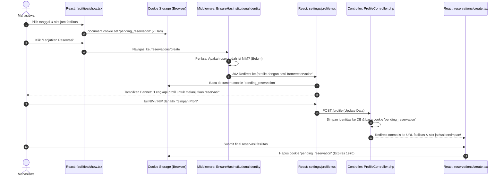

# RANGKUMAN PENERAPAN COOKIE DAN SESSION DI CODEBASE ADUPDF
**Dokumentasi Teknis Mekanisme Autentikasi, Masa Aktif (Lifetime), Keamanan, dan Studi Kasus Draf Reservasi (`pending_reservation`)**

---

## DAFTAR ISI
1. [Hubungan Simbiotik Session & Cookie di Web Modern](#1-hubungan-simbiotik-session--cookie-di-web-modern)
2. [Waktu Kedaluwarsa & Timeout Idle (Session & Cookie Lifetime)](#2-waktu-kedaluwarsa--timeout-idle-session--cookie-lifetime)
3. [Katalog Seluruh Cookie di AduPDF: Masa Berlaku & Flag Keamanan](#3-katalog-seluruh-cookie-di-adupdf-masa-berlaku--flag-keamanan)
4. [Studi Kasus Lengkap: Mekanisme Draf Reservasi Lintas Halaman (`pending_reservation`)](#4-studi-kasus-lengkap-mekanisme-draf-reservasi-lintas-halaman-pending_reservation)
5. [Praktik Keamanan Terbaik (*Security Hardening*) pada Session & Cookie AduPDF](#5-praktik-keamanan-terbaik-security-hardening-pada-session--cookie-adupdf)
6. [Matriks Ringkasan Cepat Referensi File](#6-matriks-ringkasan-cepat-referensi-file)

---

## 1. HUBUNGAN SIMBIOTIK SESSION & COOKIE DI WEB MODERN

Protokol HTTP bersifat ***stateless*** (tidak menyimpan memori atau status antara satu request dengan request berikutnya). Untuk membuat sistem login dan keranjang/draf yang mengingat pengguna, Laravel dan browser bekerja sama menggunakan dua instrumen:

```
+───────────────────────────────────────────────────────────────────────────────────+
|                       HUBUNGAN SIMBIOTIK SESSION & COOKIE                         |
+───────────────────────────────────────────────────────────────────────────────────+

       BROWSER (KLIEN)                                    SERVER & DATABASE
  ┌───────────────────────┐                            ┌───────────────────────┐
  │ Menyimpan TIKET KECIL │                            │ Menyimpan DATA LENGKAP│
  │ berupa COOKIE         │                            │ berupa SESSION        │
  │                       │                            │                       │
  │ Nama: adupdf-session  │  Setiap Request Kirim ID   │ Tabel: sessions       │
  │ Value: [Encrypted ID] │ ─────────────────────────> │ ID: [Cocokkan ID]     │
  │                       │                            │ User: ID Mahasiswa 42 │
  │                       │ <───────────────────────── │ Role: 'pengguna'      │
  │                       │    Kirim Respon & Perbarui │ Last Active: 14:00    │
  └───────────────────────┘         Masa Aktif         └───────────────────────┘
```

1. **Session (Tersimpan di Sisi Server)**:
   - Data sensitif seperti siapa user yang login, hak akses (role), dan status akun disimpan di database server pada tabel `sessions`.
   - Pengguna browser tidak bisa memanipulasi langsung isi sesi ini.
2. **Cookie (Tersimpan di Sisi Klien Browser)**:
   - Server menitipkan sebaris data kecil terenkripsi ke browser pengguna bernama `adupdf-session`.
   - Browser secara otomatis menyertakan cookie ini di header setiap kali melakukan request/klik halaman, sehingga server langsung tahu sesi mana yang harus dibuka.

---

## 2. WAKTU KEDALUWARSA & TIMEOUT IDLE (SESSION & COOKIE LIFETIME)

### A. Waktu Idle Default Tanpa Aktivitas: **120 Menit (2 Jam)**
Diatur di file konfigurasi [`config/session.php`](file:///B:/0000_UNDIP/5.%20SMT%205/PPK_PROJECTS/AduPDF_Local/AduPDF/config/session.php#L35):
```php
'lifetime' => (int) env('SESSION_LIFETIME', 120),
'expire_on_close' => env('SESSION_EXPIRE_ON_CLOSE', false),
```

#### Cara Kerjanya di Browser (*Sliding Expiration*):
- Ketika pengguna login atau berinteraksi, server mengirimkan cookie dengan atribut `Max-Age=7200` detik (2 jam).
- **Perpanjangan Otomatis:** Setiap kali pengguna berpindah halaman, mengklik menu, atau mengirim formulir, server memperbarui timestamp sesi di database dan memperpanjang masa aktif cookie kembali menjadi 2 jam ke depan.
- **Auto-Logout:** Jika pengguna membiarkan browser terbuka tanpa aktivitas apa pun selama 2 jam berturut-turut, cookie sesi akan kedaluwarsa di browser dan record sesi di database dihapus oleh garbage collector. Ketika pengguna mengklik menu kembali, pengguna otomatis diarahkan ke form login.

### B. Opsi "Remember Me" (Ingat Saya): **5 Tahun**
Diatur di [`app/Http/Controllers/Auth/AuthenticatedSessionController.php`](file:///B:/0000_UNDIP/5.%20SMT%205/PPK_PROJECTS/AduPDF_Local/AduPDF/app/Http/Controllers/Auth/AuthenticatedSessionController.php#L56):
```php
Auth::login($user, $request->boolean('remember'));
```
- Jika pengguna mencentang kotak *"Ingat saya"* saat login, Laravel menyetel cookie tambahan bernama `remember_web_*`.
- Cookie ini memiliki masa berlaku **5 tahun** (standar Laravel).
- Jika sesi 2 jam habis, sistem akan memeriksa cookie `remember_web_*` ini dan otomatis membuatkan sesi baru tanpa meminta password ulang, kecuali pengguna mengklik **Logout** secara manual.

### C. Perilaku Saat Browser Ditutup
- Nilai `'expire_on_close' => false`: Jika pengguna menutup browser lalu membukanya kembali dalam rentang waktu kurang dari 2 jam, sesi masih tetap aktif (tidak ter-logout otomatis).
- Jika ingin otomatis logout saat jendela browser ditutup, ubah `SESSION_EXPIRE_ON_CLOSE=true` di `.env`.

---

## 3. KATALOG SELURUH COOKIE DI ADUPDF: MASA BERLAKU & FLAG KEAMANAN

Codebase AduPDF mengelola 6 cookie dengan fungsi dan masa aktif yang berbeda:

| Nama Cookie | Masa Aktif (Expiration) | Dibuat Oleh | Status Enkripsi | Flag Keamanan | Tujuan & Peran |
| :--- | :--- | :--- | :--- | :--- | :--- |
| **`adupdf-session`** | **120 Menit** (sliding) | Backend Laravel | **Terenkripsi AES-256** | `HttpOnly`, `SameSite=Lax` | Menyimpan ID sesi login pengguna aktif. |
| **`XSRF-TOKEN`** | **120 Menit** (sliding) | Backend Laravel | Tidak Dienkripsi (Plain Token) | `HttpOnly=false`, `SameSite=Lax` | Token anti pemalsuan request (Cross-Site Request Forgery) untuk dibaca oleh client XHR/Inertia. |
| **`remember_web_*`** | **5 Tahun** | Backend Auth | **Terenkripsi AES-256** | `HttpOnly`, `SameSite=Lax` | Token mengingat login jangka panjang jika opsi *"Remember Me"* dicentang. |
| **`appearance`** | **365 Hari (1 Tahun)** | Frontend React | **Tidak Dienkripsi** (Bypass) | `SameSite=Lax` | Menyimpan preferensi tema visual (`light`, `dark`, `system`). |
| **`pending_reservation`** | **7 Hari** | Frontend React | **Tidak Dienkripsi** (Bypass) | `SameSite=Lax` | Menyimpan draf tanggal & slot reservasi sebelum melengkapi identitas profil. |
| **`sidebar_state`** | Mengikuti Sesi | Frontend / Browser | **Tidak Dienkripsi** (Bypass) | `SameSite=Lax` | Menyimpan status buka/tutup sidebar petugas dan admin. |

---

## 4. STUDI KASUS LENGKAP: MEKANISME DRAF RESERVASI LINTAS HALAMAN (`pending_reservation`)

### Masalah Bisnis (*Business Problem*)
Mahasiswa membuka halaman fasilitas kampus, memilih ruangan laboratorium, dan menentukan slot waktu peminjaman (misal: 3 hari sekaligus, jam 08:00–12:00 WIB). Namun, akun mahasiswa tersebut belum mengisi NIM/identitas institusional yang diwajibkan oleh kampus.

Jika sistem langsung me-redirect pengguna ke halaman profil untuk mengisi NIM tanpa menyimpan draf pilihan, **mahasiswa harus memilih ulang seluruh slot jadwal dari awal** (pengalaman pengguna yang buruk).

### Solusi Rekayasa di AduPDF
AduPDF menggunakan pola **Cookie-Backed Temporary Reservation Draft**:



---

### Peta Berkas & Blok Kode Penerapan

#### 1. Pengecualian Enkripsi Cookie di Server
* **File:** [`bootstrap/app.php` (Baris 26)](file:///B:/0000_UNDIP/5.%20SMT%205/PPK_PROJECTS/AduPDF_Local/AduPDF/bootstrap/app.php#L26)
* **Logika:** Secara default Laravel mengenkripsi semua cookie dengan AES-256. Karena JavaScript di browser perlu membaca dan menulis cookie ini secara langsung (`document.cookie`), cookie ini dimasukkan ke dalam daftar putih (*whitelist*):
  ```php
  $middleware->encryptCookies(except: ['appearance', 'sidebar_state', 'pending_reservation']);
  ```

#### 2. Penyimpanan Draf ke Cookie di Frontend
* **File:** [`resources/js/pages/facilities/show.tsx` (Baris 367–389)](file:///B:/0000_UNDIP/5.%20SMT%205/PPK_PROJECTS/AduPDF_Local/AduPDF/resources/js/pages/facilities/show.tsx#L367-L389)
* **Logika:** Setiap kali pengguna mengubah pilihan slot tanggal di kalender interaktif, React secara otomatis menyimpan payload JSON ke cookie selama 7 hari:
  ```typescript
  const payload = {
      facility_id: facility.id,
      facility_name: facility.name,
      start_time: `${selectedDays[0].date}T${selectedDays[0].availability!.slots[selectedDays[0].selectedRange!.start].start_time}`,
      end_time: `${selectedDays[selectedDays.length - 1].date}T${selectedDays[selectedDays.length - 1].availability!.slots[selectedDays[selectedDays.length - 1].selectedRange!.end].end_time}`,
      schedules: selectedDays.map((d) => ({
          date: d.date,
          start_time: d.availability!.slots[d.selectedRange!.start].start_time,
          end_time: d.availability!.slots[d.selectedRange!.end].end_time,
          slots_count: d.selectedRange!.end - d.selectedRange!.start + 1,
      })),
      url: reservationUrl,
  };

  const expires = new Date(Date.now() + 7 * 864e5).toUTCString(); // 7 hari
  document.cookie = `pending_reservation=${encodeURIComponent(JSON.stringify(payload))}; expires=${expires}; path=/; SameSite=Lax`;
  ```

#### 3. Penghapusan Cookie Saat Reset Pilihan
* **File:** [`resources/js/pages/facilities/show.tsx` (Baris 343–346)](file:///B:/0000_UNDIP/5.%20SMT%205/PPK_PROJECTS/AduPDF_Local/AduPDF/resources/js/pages/facilities/show.tsx#L343-L346)
* **Logika:** Jika user mengklik tombol "Reset Pilihan", cookie dimatikan dengan tanggal kedaluwarsa masa lalu:
  ```typescript
  const handleResetAll = () => {
      setDays((prev) => prev.map((d) => ({ ...d, selectedRange: null })));
      document.cookie = 'pending_reservation=; expires=Thu, 01 Jan 1970 00:00:00 UTC; path=/; SameSite=Lax';
  };
  ```

#### 4. Pencegatan Otorisasi Identitas oleh Middleware
* **File:** [`app/Http/Middleware/EnsureHasInstitutionalIdentity.php` (Baris 20–25)](file:///B:/0000_UNDIP/5.%20SMT%205/PPK_PROJECTS/AduPDF_Local/AduPDF/app/Http/Middleware/EnsureHasInstitutionalIdentity.php#L20-L25)
* **Logika:** Saat pengguna mengakses `/reservations/create` namun belum memiliki NIM/NIP, middleware mengalihkannya ke halaman profil dengan membawa sinyal sesi:
  ```php
  if ($user && $user->isPengguna() && ! $user->hasInstitutionalIdentity()) {
      return redirect()->route('profile.edit')
          ->with('warning', 'Lengkapi profil untuk melanjutkan reservasi')
          ->with('from', 'reservation');
  }
  ```

#### 5. Banner Khusus di Halaman Profil Frontend
* **File:** [`resources/js/pages/settings/profile.tsx` (Baris 48–55 dan 101–137)](file:///B:/0000_UNDIP/5.%20SMT%205/PPK_PROJECTS/AduPDF_Local/AduPDF/resources/js/pages/settings/profile.tsx#L48-L55)
* **Logika:** Membaca cookie via RegEx `document.cookie.match(/(?:^|; )pending_reservation=([^;]*)/)`. Jika user membuka profil secara reguler dan memiliki draf, muncul banner interaktif:
  ```tsx
  {status === 'profile-updated' && !isFromReservation && pendingReservation && (
      <div className="banner-lanjutkan-reservasi">
          <p>Profil berhasil diperbarui. Anda memiliki pilihan slot {pendingReservation.facility_name} yang tersimpan.</p>
          <button onClick={() => {
              document.cookie = 'pending_reservation=; expires=Thu, 01 Jan 1970 00:00:00 UTC; path=/; SameSite=Lax';
              setPendingReservation(null);
          }}>Abaikan</button>
          <a href={pendingReservation.url}>Lanjutkan Reservasi →</a>
      </div>
  )}
  ```

#### 6. Pembacaan Cookie di Server & Redirect Otomatis
* **File:** [`app/Http/Controllers/Settings/ProfileController.php` (Baris 53–61)](file:///B:/0000_UNDIP/5.%20SMT%205/PPK_PROJECTS/AduPDF_Local/AduPDF/app/Http/Controllers/Settings/ProfileController.php#L53-L61)
* **Logika:** Setelah data identitas tersimpan di database, controller membaca `$request->cookie('pending_reservation')`. Jika valid dan user datang dari alur reservasi, langsung di-redirect kembali ke target jadwal:
  ```php
  $from = $request->input('from') ?? $request->session()->get('from');
  $pendingReservation = $request->cookie('pending_reservation');

  if ($from === 'reservation' && $pendingReservation && $user->hasInstitutionalIdentity()) {
      $data = json_decode(urldecode($pendingReservation), true) ?: json_decode($pendingReservation, true);
      if (is_array($data) && ! empty($data['url']) && ! empty($data['facility_id']) && ! empty($data['schedules'])) {
          return redirect($data['url'])->with('success', 'Profil berhasil dilengkapi. Silakan lanjutkan reservasi Anda.');
      }
  }
  ```

#### 7. Pembersihan Akhir Saat Reservasi Berhasil Diajukan
* **File:** [`resources/js/pages/reservations/create.tsx` (Baris 139–143)](file:///B:/0000_UNDIP/5.%20SMT%205/PPK_PROJECTS/AduPDF_Local/AduPDF/resources/js/pages/reservations/create.tsx#L139-L143)
* **Logika:** Begitu form reservasi berhasil disubmit dan server mengembalikan flash message `success`, React menghapus cookie tersebut secara permanen:
  ```typescript
  useEffect(() => {
      if (success) {
          document.cookie = 'pending_reservation=; expires=Thu, 01 Jan 1970 00:00:00 UTC; path=/; SameSite=Lax';
      }
  }, [success]);
  ```

---

## 5. PRAKTIK KEAMANAN TERBAIK (*SECURITY HARDENING*) PADA SESSION & COOKIE ADUPDF

Codebase AduPDF menerapkan sejumlah perlindungan keamanan tingkat industri:

1. **Pencegahan *Session Fixation***:
   Di [`AuthenticatedSessionController.php`](file:///B:/0000_UNDIP/5.%20SMT%205/PPK_PROJECTS/AduPDF_Local/AduPDF/app/Http/Controllers/Auth/AuthenticatedSessionController.php#L58):
   `$request->session()->regenerate();` dipanggil segera setelah kata sandi diverifikasi. ID sesi lama dihancurkan dan ID baru diterbitkan agar penyerang tidak bisa membajak ID sesi pra-login.
2. **Pencegahan Akses Akun Nonaktif / Trashed**:
   Di [`EnsureUserRole.php`](file:///B:/0000_UNDIP/5.%20SMT%205/PPK_PROJECTS/AduPDF_Local/AduPDF/app/Http/Middleware/EnsureUserRole.php#L26-L29):
   Jika akun seorang user dinonaktifkan oleh admin saat user sedang berselancar, middleware langsung memutus koneksi:
   `Auth::logout(); $request->session()->invalidate(); $request->session()->regenerateToken();`
3. **Proteksi *HttpOnly***:
   Cookie autentikasi `adupdf-session` dan `remember_web_*` disetel `HttpOnly = true`, sehingga skrip JavaScript jahat (serangan XSS) **tidak bisa membaca atau mencuri token login pengguna**.
4. **Proteksi CSRF (*Cross-Site Request Forgery*)**:
   Setiap mutasi data (POST, PUT, PATCH, DELETE) wajib menyertakan token dari cookie `XSRF-TOKEN` di header HTTP `X-XSRF-TOKEN`.
5. **Proteksi SameSite Attribute**:
   Semua cookie disetel dengan `SameSite=Lax` untuk mencegah pengiriman cookie secara otomatis dari situs pihak ketiga yang mencurigakan.

---

## 6. MATRIKS RINGKASAN CEPAT REFERENSI FILE

| Kebutuhan Terkait Cookie / Session | Berkas yang Bertanggung Jawab | Baris Kunci |
| :--- | :--- | :--- |
| Mengubah masa aktif sesi login (default 120 menit) | [`config/session.php`](file:///B:/0000_UNDIP/5.%20SMT%205/PPK_PROJECTS/AduPDF_Local/AduPDF/config/session.php) | Baris 35 (`'lifetime' => ...`) |
| Mengatur pengecualian enkripsi cookie | [`bootstrap/app.php`](file:///B:/0000_UNDIP/5.%20SMT%205/PPK_PROJECTS/AduPDF_Local/AduPDF/bootstrap/app.php) | Baris 26 (`encryptCookies(except: ...)`) |
| Penyetelan cookie tema tampilan (365 hari) | [`resources/js/hooks/use-appearance.tsx`](file:///B:/0000_UNDIP/5.%20SMT%205/PPK_PROJECTS/AduPDF_Local/AduPDF/resources/js/hooks/use-appearance.tsx) | Baris 28 (`maxAge = days * 86400`) |
| Pembuatan cookie draf reservasi (7 hari) | [`resources/js/pages/facilities/show.tsx`](file:///B:/0000_UNDIP/5.%20SMT%205/PPK_PROJECTS/AduPDF_Local/AduPDF/resources/js/pages/facilities/show.tsx) | Baris 381 (`expires = Date.now() + 7 * 864e5`) |
| Pengecekan identitas NIM & lempar sinyal `from` | [`app/Http/Middleware/EnsureHasInstitutionalIdentity.php`](file:///B:/0000_UNDIP/5.%20SMT%205/PPK_PROJECTS/AduPDF_Local/AduPDF/app/Http/Middleware/EnsureHasInstitutionalIdentity.php) | Baris 20–25 (`with('from', 'reservation')`) |
| Pembacaan draf cookie & auto-redirect jadwal | [`app/Http/Controllers/Settings/ProfileController.php`](file:///B:/0000_UNDIP/5.%20SMT%205/PPK_PROJECTS/AduPDF_Local/AduPDF/app/Http/Controllers/Settings/ProfileController.php) | Baris 53–61 (`$request->cookie(...)`) |
| Tampilan banner "Lanjutkan Reservasi?" | [`resources/js/pages/settings/profile.tsx`](file:///B:/0000_UNDIP/5.%20SMT%205/PPK_PROJECTS/AduPDF_Local/AduPDF/resources/js/pages/settings/profile.tsx) | Baris 48–55 dan 101–137 |
| Pembersihan cookie draf setelah submit sukses | [`resources/js/pages/reservations/create.tsx`](file:///B:/0000_UNDIP/5.%20SMT%205/PPK_PROJECTS/AduPDF_Local/AduPDF/resources/js/pages/reservations/create.tsx) | Baris 140–143 (`expires=Thu, 01 Jan 1970`) |
| Regenerasi ID sesi login (anti-fixation) | [`app/Http/Controllers/Auth/AuthenticatedSessionController.php`](file:///B:/0000_UNDIP/5.%20SMT%205/PPK_PROJECTS/AduPDF_Local/AduPDF/app/Http/Controllers/Auth/AuthenticatedSessionController.php) | Baris 58 (`$request->session()->regenerate()`) |

---
*Dokumen ini merupakan bagian dari panduan arsitektur rekayasa perangkat lunak sistem informasi AduPDF.*
